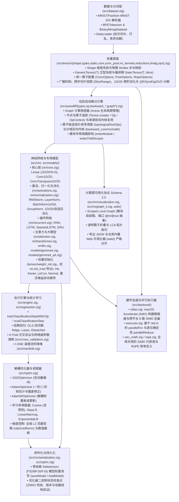
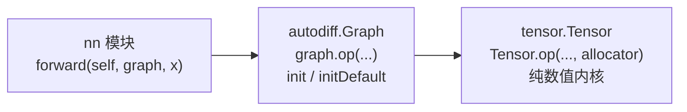

# ZNN 系统全景架构设计 (System Architecture Specification)

本文档详尽阐述 `znn` (Zig Neural Network) 深度学习与大语言模型框架的系统分层蓝图、核心数据结构、内存生命周期模型、动态自动微分机制、前沿网络算子设计以及计算图可视化体系。

---

## 1. 系统分层全景与数据流向 (System Overview & Architecture)

`znn` 采用高度解耦的分层架构设计，各子系统职责单一且模块边界清晰：

```text
src/
├── root.zig                      # 顶层公共门面 (Facade)，聚合导出所有核心子模块
├── backend.zig                   # 硬件后端与执行器门面 (导出 activation, attention_mask, logits_processor, mlx_blocks, GeluApproximation, AttentionMask, VisibleRange, Executor, cblas, mlx, offload, rope, sampling, vec_math)
├── backend/
│   ├── activation.zig            # 逐元素激活的标量公式唯一来源 (GeluApproximation：GELU 精确 erf 形式与 tanh 近似形式的前向与导数)
│   ├── attention_mask.zig        # 注意力掩码规则唯一来源 (Mask = none | causal | sliding, visibleRange, isSlidingWindowVisible, fillAdditiveMask)
│   ├── cblas.zig                 # macOS Accelerate (AMX) 构建期链接与跨平台 8 路 SIMD GEMM 后备内核
│   ├── executor.zig              # 基于 std.Io 的多核并行执行器 (parallelFor, 逐位确定性 parallelReduce)
│   ├── logits_processor.zig      # 模型无关的设备端对数几率截断 (softcapLogits)、重复惩罚 (penalizeDevice)、候选生成 (deviceCandidates) 与词元选取 (selectToken / LogitsProcessor)
│   ├── mlx.zig                   # Apple 机器学习拓展 (Machine Learning Explore, MLX) C-API 绑定、GPU 数组算子与类型安全闭包编译封装 (compileFn)
│   ├── mlx_blocks.zig            # 模型无关的 MLX GPU 组合块 (Rope, projectHeads, gatedMlp, residualScale, finalHidden)
│   ├── offload.zig               # 与模型无关的硬件加速卸载原语 (GEMM, RMSNorm, RoPE, SDPA, 滑动窗口注意力, LmHead / LmHeadWeights, TokenExclusionMask, QuantWeights, GpuKvCache)
│   ├── rope.zig                  # 旋转位置编码配置 RopeOptions (含 proportional 预设) 与旋转角数量 / 频率 / MLX 周期表的唯一公式 (CPU 与 GPU 共用)
│   ├── sampling.zig              # 通用采样基础设施 (TokenRange 排除区间, argmaxWithPenalty, BF16 排除掩码, SamplingOptions / Sampler 温度 + Top-K + Top-P 随机采样, selectTopK 部分选择, 投机采样校验)
│   ├── vec_math.zig              # SIMD 行原语的唯一来源 (exp8, sum / max / sumSquares, dot / dotBf16, axpy, softmaxRow, logSumExpRow, sigmoid, softcap, BF16 展开)
│   └── tests.zig                 # 硬件计算后端与 GPU 算子卸载单元测试集
├── tensor.zig                    # 张量门面 (导出 Tensor, GenericTensor, StaticTensor, Shape, DType, Q4Block, RopeOptions, RopeTable, AttentionMask, AttentionOptions, RmsNormOptions, attendOneQuery, embeddingLookupInto, checkIndices, losses, ops)
├── tensor/
│   ├── shape.zig                 # 8D Shape 维度系统、跨步推导与 NumPy 广播规则
│   ├── types.zig                 # DType、原生 bf16、SliceRange、ConvOptions、PoolOptions、AttentionOptions、RmsNormOptions、索引校验 (indexScalarToUsize, checkIndices) 与 GenericTensor(T)
│   ├── static.zig                # 编译期静态形状校验张量包装器 StaticTensor(T, dims)
│   ├── core.zig                  # f32 自动微分张量核心、索引、基础算术、激活函数 (含 softcap 与参数化 gelu) 与多态整型标签交叉熵
│   ├── conv_pool.zig             # 1D/2D 卷积、转置卷积、最大/平均池化与自适应平均池化数值内核
│   ├── attention_kernels.zig     # 缩放点积注意力 CPU 内核 (attendOneQuery 单查询步注意力与 attentionForward 批处理注意力，支持因果/滑动窗口掩码、Tq != Tk 与零拷贝 GQA)
│   ├── losses.zig                # 逐元素与逐行损失计算核 (ceRow, accumulateCeGradRow, dpoTerm, grpoTerm)，供 Tensor、Op.forward 与反向传播共用
│   ├── nn_kernels.zig            # 归一化 (RMSNorm 含可选权重与 weight_offset, LayerNorm, BatchNorm1d/2d, GroupNorm)、Dropout、RoPE、嵌入查表 (embedding, embeddingLookupInto) 与 BatchMatMul
│   ├── rope.zig                  # RopeTable：CPU RoPE 前向、反向与增量解码共用的旋转表 (init / angles / applyRow(inverse))
│   ├── reductions.zig            # 多轴归约 (sum, mean, var, std, min, max, argmin, argmax)、条件掩码、跨步切片与排序检索
│   ├── quant.zig                 # 4-bit 量化 (Q4Block split-half 排布)、F32/BF16 量化 (quantizeSlice / quantizeSliceBf16)、反量化与矩阵乘法 (q4MatMulInto / q4MatMul)
│   ├── linalg.zig                # 豪斯霍尔德 QR 分解 (qr)、雅可比对称特征分解 (symeig) 与单边雅可比奇异值分解 (svd)
│   ├── weight_init.zig           # He, Xavier, LeCun, Normal, Uniform 权重初始化与激活增益计算 (经 nn.init_mod 导出)
│   ├── ops.zig                   # 张量创建工厂、拼接切分 (concat/split/stack) 与线性方程组求解
│   └── tests.zig                 # 张量与线性代数单元测试集
├── autodiff.zig                  # 自动微分门面 (导出 Graph, GraphOptions, Op, OpType, OpContext)
├── autodiff/
│   ├── types.zig                 # 算子枚举 OpType (含 GeluTanh, Softcap, Attention, Q4MatMul)、算子上下文联合体 OpContext 与 Op 节点数据结构
│   ├── op.zig                    # 单源前向重演 (op.forward) 与反向传播 (op.backward) 分发
│   ├── backward_core.zig         # 核心算子反向传播 (MatMul, 激活, 损失函数, 形状/视图, 广播四则运算)
│   ├── backward_nn.zig           # 神经网络算子反向传播 (1D/2D Conv/Deconv, Pooling, Norm, RoPE, Attention)
│   ├── backward_math.zig         # 初等数学、正则化、按轴归约与条件切片算子反向传播
│   ├── graph.zig                 # Graph 核心容器 (GraphOptions, 模式配置, executor 注入, 拓扑调度与作用域栈)
│   ├── graph_nn.zig              # 神经网络、损失函数、Q4 矩阵乘与正则化计算图算子构建器 (CPU/GPU 统一注册 Op 节点)
│   ├── graph_init.zig            # 自动权重初始化、扇入/扇出推导、数学公式推导与初始化报告
│   └── tests.zig                 # 自动微分与计算图单元测试集
├── nn.zig                        # 神经网络门面 (导出所有网络层、损失、序列化、可视化与反射工具)
├── nn/
│   ├── core.zig                  # Linear (可选偏置, 1D/2D/N-D), Q4Linear, Conv1D, Conv2D, ConvTranspose1D, ConvTranspose2D, Sequential, releaseModuleGrads, createLayerScalar
│   ├── module.zig                # 基于 nn.walk 的编译期结构反射协议、持久化参数张量分配/释放 (含 tied weights 去重释放)
│   ├── activations.zig           # ReLU, LeakyReLU, Sigmoid, Tanh, GELU (精确 / tanh 近似), SiLU 激活层
│   ├── normalization.zig         # RMSNorm (支持可选权重与 weight_offset), LayerNorm, BatchNorm1d, BatchNorm2d, GroupNorm, Dropout 与 1D/2D/自适应池化层
│   ├── recurrent.zig             # RNNCell, GRUCell, 泛型时序展开容器 Recurrent(Cell), RNN, GRU, LSTMCell, LSTM, StackedLSTM 与命名返回结构体
│   ├── attention.zig             # LayerKVCache, KVCache, ScaledDotProductAttention, 泛型 GQAAttention(Proj), CausalSelfAttention (MHA/GQA/MQA), MLACache, MLALayer
│   ├── transformer.zig           # Embedding, MLP, 泛型门控前馈网络 GatedMLP(Proj), SwiGLU, MoELayer (可配置专家激活), TransformerBlock
│   ├── llm.zig                   # LoRALinear, SFT/DPO/GRPO 对齐损失函数与投机采样草稿引擎 (SpeculativeDraftEngine, promptLookup)
│   ├── serialization.zig         # 零依赖 Safetensors (F32/BF16/F16) 零拷贝内存映射归档解析 (SafetensorsArchive) 与模型权重序列化
│   ├── visualization.zig         # Schema 2.0 节点/边枚举、作用域解析与局部图构建器 LocalGraphBuilder
│   ├── graph_ir.zig              # 模型层级树构建 (graph_ir.build) 与 JSON 序列化导出 (nn.generateJson / nn.exportJson)
│   ├── model_graph.schema.json   # 模型图 JSON Schema (draft 2020-12, Schema 2.0)
│   ├── testing_init.zig          # 测试与基准测试内部初始化辅助函数
│   ├── tests.zig                 # 核心网络层、循环网络、Transformer/LLM 与 Safetensors 测试
│   ├── tests_init.zig            # 权重自动初始化与增益推导专项测试
│   └── tests_module.zig          # 编译期反射协议、字段路径命名与权重共享 (Tied Weights) 生命周期测试
├── models.zig                    # 专用模型门面 (导出 gpt, gemma4, gemma4_q4, gemma4_gpu, gemma4_e4b, GPT, GPTConfig, TransformerDecoder, DefaultGPT, Gemma4E4BModel)
├── models/
│   ├── gpt.zig                   # GPT 架构定义 (GPTConfig, TransformerDecoder, GPT, DefaultGPT)
│   ├── gemma4.zig                # Gemma 4 配置、泛型注意力与解码层 (Gemma4AttentionT, Gemma4DecoderLayerT)、全精度模型 (Gemma4ForCausalLM, TinyGemma4) 与词表/对话模板 (Gemma4Vocabulary)
│   ├── gemma4_q4.zig             # Gemma 4 架构 4-bit 量化实现与统一流式生成会话 (Gemma4Q4ForCausalLM.generate / Generation, TinyQ4Gemma4)
│   ├── gemma4_gpu.zig            # Gemma 4 GPU 推理共享组件与 12B 端到端解码上下文 (Gemma4GpuLayer, Gemma4GpuContext 含无偏投机采样校验)
│   ├── gemma4_e4b.zig            # Gemma 4 E4B (Effective 4B) 4-bit/8-bit 混合量化端侧推理引擎 (PleWeights, GpuLayerE4B, Gemma4E4BModel)
│   ├── tests.zig                 # Gemma 4 全精度、4-bit 量化、E4B 推理引擎与对话模板单元测试
│   └── tests_vis.zig             # 可视化作用域归属、Schema 2.0 黄金边集与 18 个经典模型导出测试
├── optim.zig                     # SGD, Adam, AdamW 优化器、4 类学习率调度器、梯度裁剪与 ZNNO 检查点
├── engine.zig                    # 分类任务训练与无梯度评估引擎 (Step / Epoch 执行器)
├── dataset.zig                   # MNIST/Fashion-MNIST IDX 加载器、DataLoader、BPETokenizer 与 BinaryMmapDataset
├── regression.zig                # OLS、Ridge、Lasso、ElasticNet 经典回归算法
├── cross_validation.zig          # 分层 K-Fold 交叉验证、StandardScaler 与网格超参数搜索
├── manifold.zig                  # t-SNE 高维流形降维算法
├── bench.zig                     # 性能基准门面与 GEMM/张量/激活/执行器/Q4/解码基准测试
├── bench/
│   ├── runner.zig                # 基准统计运行器 (BenchmarkRunner) 与结果表格输出
│   └── suites.zig                # 算子层、完整模型、优化器、分词器、执行器、Q4 与解码基准测试套件
└── tests.zig                     # 全库根测试聚合器与端到端集成测试
```



---

## 2. 张量底座系统 (Tensor Subsystem)

### 2.1 物理存储与逻辑形状 (Shape & Strides)
张量底层为一维连续浮点切片 `data: []f32`，多维空间映射由 `Shape` 与 `strides` 共同决定：
* **`Shape`**：记录张量的各维度尺度，如 `[batch_size, seq_len, num_heads, head_dim]`；
* **`strides`**：表示在特定轴推进一个元素时，底层一维索引需跳跃的物理偏移量；
* **行优先连续布局 (Row-Major Contiguous)**：
  $$
  \text{stride}[d] = \prod_{k=d+1}^{N-1} \text{shape}[k], \quad \text{stride}[N-1] = 1
  $$
* **多维寻址映射**：对多维坐标 $(i_0, i_1, \dots, i_{N-1})$，物理偏移为：
  $$
  \text{offset} = \sum_{d=0}^{N-1} i_d \times \text{strides}[d]
  $$

### 2.2 广播机制 (NumPy-Style Broadcasting)
当对两个形状不同的张量执行逐元素二元运算时（如 $A + B$），系统遵循标准 NumPy 广播语义：
1. **维度对齐**：从尾部轴向前逐一比对维度大小；若其中一个张量维度较少，则在高维方向隐式补 $1$；
2. **合法性检查**：对于对齐的轴 $d$，必须满足 $\text{dim}_A[d] == \text{dim}_B[d]$ 或其中之一为 $1$；
3. **步长变换 (`computeBroadcastStrides`)**：若张量在轴 $d$ 上的尺寸为 $1$，则将其在广播输出中的计算步长强制置 $0$（实现虚拟重复访问而不消耗额外内存）。

### 2.3 三层张量类型体系与跨步切片 (`Tensor`, `GenericTensor`, `StaticTensor` & `SliceRange`)
`src/tensor/` 提供三层互补的张量抽象：

| 抽象类型 | 位置 | 元素类型 | 形状校验 | 自动微分追踪 | 典型应用场景 |
| :--- | :--- | :--- | :--- | :--- | :--- |
| **`Tensor`** | `src/tensor/core.zig` | `f32` (`data: []f32`, `grad: []f32`) | 运行期 (`Shape`, 最高 8 维) | 支持 (`creator: ?*OpHandle`, `requires_grad`) | 动态神经网络前向/反向传播、BLAS/SIMD 矩阵乘法、卷积、注意力与损失函数 |
| **`GenericTensor(T)`** | `src/tensor/types.zig` | `f32`, `f64`, `bf16`, `i32`, `i64`, `usize`, `bool` | 运行期 (`Shape`, 最高 8 维) | 纯数据容器与视图 | Token 索引批次 (`UsizeTensor`, `IntTensor`)、布尔掩码 (`BoolTensor`)、`bf16` 存储与跨类型转换 (`to`/`fromGeneric`) |
| **`StaticTensor(T, dims)`** | `src/tensor/static.zig` | 任意数值类型 `T` | **编译期** (`comptime dims`) | 包装 `*GenericTensor(T)` | 编译期维度校验（`@compileError` 拦截矩阵乘法内维不匹配、加法形状不一致或非法 `reshape`） |

* **`SliceRange` 跨步切片**：提供带 `step` 步长的任意子区间索引能力，支持零拷贝切片视图（`is_view` 生命周期保护）与连续化拷贝 (`contiguous`)。

### 2.4 统一算子配置结构体 (`ConvOptions`, `PoolOptions` & `RopeOptions`)
* **`ConvOptions` (`src/tensor/types.zig`)**：`stride: usize = 1, padding: usize = 0`，统一用于 `conv1d`、`conv2d`、`convTranspose1d`、`convTranspose2d`；
* **`PoolOptions` (`src/tensor/types.zig`)**：`stride: ?usize = null, padding: usize = 0`（提供 `resolveStride(pool_size)`，当 `stride == null` 时默认等于 `pool_size`），统一用于 `maxpool1d`、`avgpool1d`、`maxpool2d`、`avgpool2d`；
* **`RopeOptions` (`src/backend/rope.zig`，经 `tensor.RopeOptions` 导出)**：`rotary_offset: usize = 0, base: f32 = 10000.0, mode: Mode = .interleaved, partial_rotary_factor: f32 = 1.0`（支持 `.interleaved` 相邻配对与 `.split_half` 半切分配对以及比例旋转因子），统一用于 `Tensor.rope(start_pos, options, alloc)`、`Graph.rope(x, start_pos, options)`、`MLALayer.rope` 与 Gemma 4 的 `GpuRope`。旋转子空间 `rot_dim = head_dim - rotary_offset`，参与旋转的角度数 `num_angles = floor(rot_dim / 2 * partial_rotary_factor)`，频率分母始终是完整 `rot_dim`，半切分配对间距为 `rot_dim / 2`，其余角度保持恒等；`RopeOptions.proportional(theta, factor)` 是 Hugging Face / mlx-lm 比例旋转位置编码 (Proportional RoPE) 的预设，`fillPeriods` 生成 MLX `fast.rope` 的周期表。
* **`RopeTable` (`src/tensor/rope.zig`)**：`init(head_dim, options)` 预计算频率，`angles(pos, cos, sin)` 每个位置只算一次三角函数，`applyRow(row, cos, sin, comptime inverse)` 原地旋转一行；CPU 前向内核、RoPE 反向传播 (`inverse = true`，dX = Rᵀ dY) 与 `MLALayer.forwardInference` 共用这一份旋转实现。

### 2.5 4-bit 分块量化与 Split-Half 向量化排布 (`src/tensor/quant.zig`)
为满足大语言模型（如 Gemma 4）在端侧的高速低显存/低内存推理，`src/tensor/quant.zig` 实现了 split-half 排布的 `Q4Block`：
* **块结构**：每块包含 32 个权重，存储为一个 16 位浮点数 `scale: f16`（绝对值最大值除以 7.0）与 16 字节 `qs: [16]u8`，总计 18 字节（平均每个权重 4.5 bit，对齐 ggml Q4_0 标准）。
* **Split-Half 块内排布**：第 $j$ 个字节（$j \in [0, 15]$）的低 4 位存储权重 $w_j$，高 4 位存储权重 $w_{j+16}$。相比传统奇偶交错存储，split-half 排布允许 CPU SIMD 或 GPU 线程在计算点积时按连续的 8 浮点数或 16 浮点数向量批量加载激活值并完成半字展开，消除了交替解包的步长跳转。
* **高吞吐 GEMV 与 GEMM 内核 (`q4MatMulInto`)**：
  * 输出按（8 行 × 128 列）二维分块，由计算图注入的 `Executor` 并行（`Graph.q4MatMul` 使用 `graph.executor()`）；分块内每个权重块只以 16 路向量解包一次并复用于各行，每个输出元素由单一分块按固定块序累加，因此串行、多线程与逐行计算结果逐位一致；
  * 单行输入（自回归解码）：128 核 Linux 虚拟机上 3840×15360（权重 33 MB）单线程约 11.6 ms（2.8 GB/s，v0.3.0 交错排布为 19.7 ms / 1.7 GB/s），用满全部核心约 0.9–1.2 ms（28–36 GB/s）；
  * 多行输入（Prompt Prefill）：同一形状、全部核心下 T=4 / 16 / 64 行分别约 1.3 / 2.8 / 7.4 ms；
  * `q4MatMulInto` 要求连续输入（允许连续切片视图，按 `shape.numel()` 推算行数），分配式 `q4MatMul` 会先物化非连续输入。
* **二进制魔数升级**：模型文件魔数直接升级为 `ZNNQ4G02`，量化工具 `quantize_gemma4` 与模型加载器同步迁移。

---

## 3. 动态自动微分引擎 (Dynamic Autodiff & Computation Graph)

### 3.1 磁带式前向记录与动态拓扑 (Tape Recording)
`znn` 采用动态反向模式自动微分 (Dynamic Reverse-Mode Automatic Differentiation)：
* **前向传播记录**：在运算发生时，动态创建输出 `Tensor`，将其 `creator` 指向生成该张量的 `Op` 结构体；
* **反向传播调度**：
  1. 调用 `graph.backward(loss)`，从目标张量的创建算子开始执行基于算子节点 (`*Op`) 的深度优先后序遍历 (`topologicalSortOps`)；
  2. 生成严格的算子逆拓扑排序序列，确保多输出算子（如 `Split`）在所有下游分支梯度汇总完毕后仅执行一次；
  3. 将损失张量的梯度初始化为 $1.0$ (`loss.grad[0] = 1.0`)；
  4. 逆序遍历算子节点，调用 `op.backward(op)`（按算子领域分发至 `backward_core.zig`、`backward_nn.zig` 与 `backward_math.zig`），将梯度链式回传并累加至输入张量的 `grad` 切片中。

### 3.2 批次级内存池架构 (Arena Allocator Lifecycle)
深度学习训练循环中频繁产生大量的临时激活张量、中间形状与梯度切片。若通过通用的操作系统堆分配器频繁申请和释放，极易导致高昂的系统调用开销与内存碎片。

`znn` 采取了明确的双轨制内存设计：
1. **持久权重 (Persistent Weights)**：模型参数（如 `Linear.weight`、`Conv2D.bias`）通过调用者传入的通用分配器（GPA）分配，生命周期跨越整个训练过程，在模块 `deinit` 时集中释放；
2. **批次临时张量 (Ephemeral Activations & Gradients)**：计算图内部内置 `std.heap.ArenaAllocator`。每次前向计算和反向传播中生成的所有中间张量、Op 节点及临时缓冲区均从 Arena 中分配。在批次迭代结束时（`graph.reset()` 或 `graph.deinit()`），整块 Arena 内存被以 $O(1)$ 代价瞬间回收，彻底规避内存泄漏与指针悬挂。

### 3.3 模块作用域跟踪 (Module Scoping in Graph)
为了支持深层神经网络的层次化拓扑推导与可视化导出，`Graph` 维护了一个当前正在执行 forward 的作用域栈：
* **`graph.enterModule(name, module_type)`**：模块在 forward 开始前压栈，通过 `defer scope.exit()` 保证在退出作用域时自动弹栈；模块未命名时返回空守卫。库层统一通过 `nn.enterModuleScope(graph, self)` 调用它，并顺带登记模块的 `pub const formula`：
  ```zig
  const module_scope = try enterModuleScope(graph, self);
  defer module_scope.exit();
  ```
* **`graph.enterChildScope(local_name, module_type)`**：用于模块内部复杂子逻辑（如注意力机制内部的 "core" 运算）的命名空间隔离；
* 运算过程中创建的所有算子与激活张量均自动打上当前作用域标签 (`Op.scope` / `Tensor.scope`)。导出时 `graph_ir` 依据作用域路径重建模块树；子模块切片 / 数组对应的中间层级（路径段为数字，如 `gpt.decoder.h.0`）标记为 `ModuleList`。

### 3.4 分层依赖：Tensor ← Graph ← nn (Layered Dependencies)
包与包之间是严格的单向依赖，跨包 `@import` 只能指向更底层的包，由 `zig build check-layers`（[`tools/check_layers.zig`](../tools/check_layers.zig)，同时作为 `zig build test` 的一部分）逐文件检查：

| 层级 | 包 |
| :--- | :--- |
| 0 | `backend` |
| 1 | `tensor`、`dataset` |
| 2 | `autodiff`、`regression`、`manifold` |
| 3 | `nn`、`cross_validation` |
| 4 | `optim`、`models` |
| 5 | `engine` |
| 6 | `bench` |
| 7 | `root`（`root.zig` 与根测试汇总 `tests.zig`） |

同一包内的文件互相导入不受限制（`Tensor` 的方法实现分布在 `tensor/` 的多个文件中，`Graph` 的方法实现分布在 `graph.zig`、`graph_nn.zig` 与 `graph_init.zig` 中）。

* **`tensor` 层 (`src/tensor/`)**：纯数值张量库。所有 `Tensor` 方法与 `tensor.concat` / `tensor.split` / `tensor.quant.q4MatMulInto` 只接收 `allocator` 或 `Executor`，执行纯计算并返回新张量 (或零拷贝视图)，从不调用 `Graph`。`Tensor` 仅以数据字段 (`grad`、`requires_grad`、`creator`、`scope`) 承载自动微分元数据；`creator` 的类型是张量层定义的不透明句柄 `tensor.OpHandle`，由 `autodiff.Op.handle()` 写入、`autodiff.Op.creatorOf(t)` 还原为 `*Op`，因此 `tensor` 不依赖 `autodiff`。权重初始化算法 (`tensor/weight_init.zig`) 同样位于张量层，供 `autodiff` 的自动初始化与 `nn` 共用。
* **`autodiff` 层 (`src/autodiff/`)**：`Graph` 的每个算子 (`graph.matmul`、`graph.q4MatMul`、`graph.add`、`graph.softmax` …) 先在自身 Arena 上调用对应的纯 `Tensor` 内核完成前向计算，再按 `enable_grad` 决定是否记录 `Op` 节点；`Op` 数据结构位于 `types.zig`，前向重演与反向传播分发位于 `op.zig`（`op.forward` / `op.backward`），反向内核文件只依赖 `Op` 数据结构。基于图结构的权重自动初始化与初始化报告位于 `graph_init.zig`，只依赖张量层。
  * `Graph.init(allocator, options: GraphOptions)`：统一图入口，接收 `enable_grad`、`mode`（`.eager` / `.deferred`）与 `io` 异步执行器；
  * `Graph.initDefault(allocator)`：默认训练图入口（等价于 `Graph.init(allocator, .{})`）；
  * `Graph.init(allocator, .{ .enable_grad = false })`：推理 / 评估模式，只执行前向计算，不记录 `Op`，不分配梯度缓冲，中间张量仍在 Arena 中随 `deinit` 一并释放；
  * `graph.executor()`：获取当前注入的执行器（`Executor.serial` 或基于 `std.Io.Threaded` 的并行执行器）；
  * `graph.arenaAllocator()`：获取计算图 Arena 分配器，用于与计算图同生命周期的临时缓冲区 (如 `RNN.forward` 返回的输出切片)。
* **`nn` 层 (`src/nn/`)**：所有模块的前向统一为 `forward(self, graph: *Graph, x, ...)`，只通过计算图执行算子，没有 Eager / Graph 双分支，也不需要手动释放中间张量。推理时调用方传入 `Graph.init(allocator, .{ .enable_grad = false })` 构建的计算图即可。计算图 JSON 导出属于 `nn`：`nn.generateJson(&graph, allocator)` / `nn.exportJson(&graph, path, allocator)`。训练循环位于上层的 `engine`（`engine.trainClassificationStep` 等），`nn` 不再转导出。
* **KV-Cache 单步推理** (`CausalSelfAttention.forwardInference` / `MLALayer.forwardInference`)：在函数内部创建局部无梯度计算图承载中间张量，最终输出拷贝到调用方分配器上返回。



---

## 4. 神经网络子系统架构 (Neural Network Modules Zoo)

### 4.1 模块协议与编译期反射遍历 (`nn/module.zig`)
模块就是普通 struct，遵循“**数据与逻辑分离、状态外置**”的标准，与 PyTorch `nn.Module` 一样通过字段自动注册参数与子模块：
* 模块内部仅持有自身的参数张量与超参数配置，无需知晓优化器的存在；
* **统一遍历 `nn.walk(model, visitor)`**：编译期展开字段，按字段路径（如 `cell.w_ih_r.weight`、`layers.0.attn.q_attn.bias`）访问全部张量与子模块，支持：
  - 张量指针 (`*Tensor`) 与可选张量指针 (`?*Tensor`，如 `ConvTranspose2D.bias`、`LoRALinear.bias`)；
  - 动态张量切片 (`[]*Tensor`)、动态子模块切片 (`[]ChildStruct`，如 `MoELayer` 专家、`StackedLSTM` 各层) 与 `[]f32` 缓存；
  - 定长张量数组 (`[N]*Tensor`)、定长子模块数组 (`[N]ChildStruct`) 与嵌套子模块；
  - 自动跳过编译期字段（如 `nn.sequential(.{ ..., nn.ReLU{} })` 元组中的激活层字面量）与零大小字段。
  访问者可声明 `visitTensor`（必需）、`enterModule`（进入子模块前调用，可返回 `false` 剪枝）、`visitOwnedSlice`（释放切片）与 `wants_path`（需要字段路径时声明）。
* **构建在 `walk` 之上的模块操作**（与 PyTorch 对应）：
  | znn | PyTorch |
  |---|---|
  | `nn.parameters(&m, alloc)` | `m.parameters()` |
  | `nn.namedParameters(&m, alloc)`（键与 Safetensors 序列化一致） | `m.named_parameters()` |
  | `nn.numParameters(&m)` | `sum(p.numel() for p in m.parameters())` |
  | `nn.setRequiresGrad(&m.sub, alloc, false)`（冻结时释放梯度缓冲，解冻时重新分配） | `m.sub.requires_grad_(False)` |
  | `nn.zeroGradModel(&m)` / `nn.deinitModel(&m, alloc)` | `m.zero_grad()` / 析构 |
  | `nn.trainModel(&m)` / `nn.evalModel(&m)`（更新含 `training: bool` 字段的模块，如 `BatchNorm2d`、`Dropout`） | `m.train()` / `m.eval()` |
  | `nn.callForward(&m, &g, x)` / `nn.callForward(&m, &g, .{ x, h_0 })` | `m(x)` / `m(x, h_0)` |
  `customInit` 分派、Safetensors 读写 (`saveModel` / `loadModel`) 也都基于同一遍历；`parameters` 只收集 `requires_grad == true` 的张量，冻结权重（如 `LoRALinear.weight`）与缓冲区不在其中。
* **库层只声明数据**：每个库层只包含参数 / 子模块字段、`name: ?[]const u8 = null`、`module_type`、可选的 `pub const formula`，以及 `init` / `forward` 等计算逻辑；释放、清零梯度与命名不再由各层手写，全部由上表中的通用函数完成（没有 `Linear.deinit`、`Linear.zeroGrad`、`Linear.setName` 之类的逐层方法）。
* **按字段路径自动命名 `nn.nameModules(&m, arena, root)`**：与 PyTorch `named_modules()` 一样，子模块名称即字段路径。含 `name` 字段的子模块得到 `root.<字段路径>`，张量得到 `root.<字段路径>`（如 `gpt.decoder.h.0.attn.c_attn.weight`、`deep_lstm.layers.1`）；`root` 为空串时根模块保持未命名、子模块使用相对路径。名称字符串分配在调用方传入的 arena 中，模型按值移动后仍然有效，arena 须在模型使用期间保持存活：
  ```zig
  var names = std.heap.ArenaAllocator.init(allocator);
  defer names.deinit();
  try nn.nameModules(&gpt, names.allocator(), "gpt");
  ```
* **`nn.Module(T)` 包装器**：持有 `allocator`、内部模型与名称 arena。`init` 返回错误联合并自动以空根路径为子模块命名，`setName(root)` 重置 arena 后按新根路径重新命名；提供 `forward`（单个输入直接传入，多个输入以元组传入，如 `gru.forward(&g, .{ inputs, h_0 })`，返回类型与内部模型的 `forward` 相同）、`parameters` / `namedParameters` / `numParameters` / `setRequiresGrad`、`initParameters` / `initParametersWithSample`、`zeroGrad` / `train` / `eval` / `save` / `load` / `deinit`。
* 所有库层的 `forward` 统一以 `self: *const Self` 接收自身，避免按值复制整个模块。

### 4.2 权重初始化与增益管理 (`tensor/weight_init.zig`)
根据网络激活函数的不同数学曲率，系统提供完备的方差缩放初始化策略：
* **`calculateGain(nonlinearity)`**：
  - ReLU / LeakyReLU: $\text{gain} = \sqrt{2.0}$
  - Tanh: $\text{gain} = 5.0 / 3.0$
  - Linear / Identity / Sigmoid: $\text{gain} = 1.0$
* **初始化方法集 (`InitMethod`)**：
  - **He (Kaiming) Normal / Uniform**：针对深层 ReLU / GELU 网络的方差平衡；
  - **Xavier (Glorot) Normal / Uniform**：针对 Sigmoid / Tanh 的对称双端收敛；
  - **LeCun Normal**：自归一化神经网络推荐；
  - **两阶段构造：`init` 只分配，前向计算图建立后由 `nn.initModel` 统一初始化**：所有库层（`Linear`、`Conv2D`、`ConvTranspose2D`、`Embedding`、RNN / LSTM / GRU 系列、`CausalSelfAttention`、`MLP`、`SwiGLU`、`MoELayer`、`MLALayer`、`TransformerBlock`、`GPT`、`LoRALinear` 等）的 `init` 不接收也不消耗随机数，只分配参数内存（全零）并设置与随机无关的结构默认值（归一化层 γ = 1 / β = 0、LSTM 遗忘门偏置 1.0，后者同时记录在 `Tensor.init_constant` 中）。参数数值的初始化依赖网络拓扑与激活函数，因此必须在前向计算图建立之后进行：
    - `nn.initModel(&model, &graph, random)`（或 `Module(T).initParameters(&graph, random)`）：`graph` 是用样本输入执行过一次 `model.forward` 的可记录计算图（`Graph.init`；`Graph.initNoGrad` 不记录算子，返回 `error.GraphNotRecordingOps`）。第一步，编译期反射递归查找定义了 `customInit` 的库外模块并调用，将其全部可训练参数标记为 `is_custom_initialized = true`（`CUSTOM_INIT`）；`customInit` 支持确定性签名 `fn(self: *Self) void`（常量、预设矩阵等，不消耗随机数）与随机签名 `fn(self: *Self, random: std.Random) void`。第二步，调用 `Graph.initWeights(random)`，对其余参数沿计算图探测下游消费算子与激活函数推导初始化策略（`AUTO_GRAPH`）：ReLU / GELU / SiLU / LeakyReLU → He Normal（按增益缩放）、Tanh / Sigmoid → Xavier Normal、SELU → LeCun Normal、Embedding → Normal(0, 0.02)、LoRA B → 0、归一化 γ → 1、带 `init_constant` 的参数 → 该常量、其余偏置 → 0。fan_in / fan_out 由直接消费该参数的算子确定（`Graph.computeParamFans`）：`MatMul` / `BatchMatMul` 区分右操作数 `y = xW`（`[in, out]`）与左操作数 `y = Wx`（`[out, in]`），`Conv2D` 卷积核按 `[out_c, in_c, kh, kw]`、`ConvTranspose2D` 卷积核按 `[in_c, out_c, kh, kw]` 计算，参数先经 `Transpose` 再投影时按转置后的张量确定，图中没有这些算子时才按形状推断。Debug 构建下，未被计算图触达且未自定义初始化的可训练参数会通过 `std.log.warn` 报告（例如样本未路由到的 MoE 专家）。
    - `nn.initModelWithSample(&model, allocator, random, .{x})`（或 `Module(T).initParametersWithSample(random, .{x})`）：便捷入口，内部用样本参数元组建立一次前向计算图后调用 `nn.initModel`。
    - `Layer.resetParameters(random, options)`：库层在已分配张量上按 `InitOptions` 重新填充的标准算法，供库外代码显式指定初始化（例如在 `customInit` 中复用，或单独初始化不经过计算图的冻结参数）。
    - 内置库层不定义 `customInit`；`customInit` 仅由库外用户模块定义。

    ```zig
    // 库外用户模块：通过 customInit 指定确定性初始化
    const Head = struct {
        fc: nn.Linear,

        pub fn forward(self: *const Head, graph: *autodiff.Graph, x: *Tensor) !*Tensor {
            return self.fc.forward(graph, x);
        }

        pub fn customInit(self: *Head) void {
            @memset(self.fc.weight.data, 0.0);
            @memset(self.fc.bias.data, 0.0);
        }
    };

    const MyModel = struct {
        fc: nn.Linear, // 未自定义：依据计算图中下游的 ReLU 采用 He Normal
        head: Head,    // 自定义：customInit 设置的数值不会被覆盖

        pub fn init(allocator: std.mem.Allocator) !MyModel {
            return .{ .fc = try nn.Linear.init(allocator, 16, 32), .head = .{ .fc = try nn.Linear.init(allocator, 32, 4) } };
        }

        pub fn forward(self: *const MyModel, graph: *autodiff.Graph, x: *Tensor) !*Tensor {
            return self.head.forward(graph, try graph.relu(try self.fc.forward(graph, x)));
        }
    };

    // 方式一：直接使用模型结构体
    var model = try MyModel.init(allocator); // 只分配内存
    defer nn.deinitModel(&model, allocator);
    {
        var graph = autodiff.Graph.init(allocator);
        defer graph.deinit();
        _ = try model.forward(&graph, try graph.ones(&.{ 1, 16 }, false)); // 建立前向计算图
        try nn.initModel(&model, &graph, prng.random()); // customInit → Graph.initWeights
    }

    // 方式二：使用 nn.Module 包装，并以真实样本批次建立计算图
    var module = try nn.Module(MyModel).init(allocator, try MyModel.init(allocator));
    defer module.deinit();
    try module.initParametersWithSample(prng.random(), .{sample_batch});
    ```
    - **调试构建下的未初始化检查**：优化器 (`SGDOptimizer` / `AdamOptimizer` / `AdamWOptimizer`) 构造时调用 `nn.warnIfParametersUninitialized`，在 Debug 构建下若所有可训练权重矩阵都全为 0 (偏置、归一化 γ / β 等向量形参数不参与判断) 则输出 `std.log.warn` 提示先建立前向计算图再调用 `nn.initModel` / `nn.initModelWithSample`；非 Debug 构建下为空操作。统计逻辑通过 `nn.inspectParameterInit` 返回 `ParameterInitReport`，可在自定义训练循环中直接使用。

### 4.3 一维/二维卷积、自适应池化与归一化层 (`nn/core.zig`, `nn/normalization.zig`)
1. **一维与二维卷积及转置卷积 (`Conv1D`, `Conv2D`, `ConvTranspose1D`, `ConvTranspose2D`, `nn/core.zig`)**：
   - 正向卷积 `Conv1D` (`[B, C_in, L]` → `[B, C_out, L_out]`) 与 `Conv2D` (`[B, C_in, H, W]` → `[B, C_out, H_out, W_out]`) 接收 `tensor.ConvOptions`；
   - 转置卷积 `ConvTranspose1D` 与 `ConvTranspose2D` 统一采用 `Options = struct { stride: usize = 1, padding: usize = 0, use_bias: bool = true }`（提供 `default` 与 `defaultOptions()`），完整支持前向与反向传播及 `computeParamFans` 扇入/扇出推导。
2. **一维/二维池化与自适应平均池化 (`nn/normalization.zig`)**：
   - `MaxPool1D`、`AvgPool1D`、`MaxPool2D`、`AvgPool2D` 统一接收 `tensor.PoolOptions = struct { stride: ?usize = null, padding: usize = 0 }`（`stride` 为 `null` 时通过 `resolveStride` 自动默认等于窗口大小）；
   - `AdaptiveAvgPool1D` (`[B, C, L_in]` → `[B, C, L_out]`) 与 `AdaptiveAvgPool2D` (`[B, C, H_in, W_in]` → `[B, C, H_out, W_out]`) 采用标准起止窗口映射 $s_i = \lfloor i \cdot L_{\text{in}} / L_{\text{out}} \rfloor$、$e_i = \lceil (i + 1) \cdot L_{\text{in}} / L_{\text{out}} \rceil$，并在反向传播中将上游梯度精确均分回传至对应感受野。
3. **归一化层体系 (`RMSNorm`, `LayerNorm`, `BatchNorm1d`, `BatchNorm2d`, `GroupNorm`, `nn/normalization.zig`)**：
   - `BatchNorm1d`（支持 `[N, C]` 与 `[N, C, L]` 输入）与 `BatchNorm2d`（支持 `[N, C, H, W]` 输入）在训练模式下更新 `running_mean` / `running_var`，评估模式下使用运行统计量归一化；
   - `GroupNorm` 支持 3D `[N, C, L]` 与 4D `[N, C, H, W]` 等 `[N, C, ...]` 输入，校验 `num_channels % num_groups == 0`。

### 4.4 现代大模型架构核心 (`nn/attention.zig`, `nn/transformer.zig`, `nn/llm.zig`)
1. **因果多头自注意力 (`CausalSelfAttention`, `nn/attention.zig`)**：
   - 包含 $Q, K, V$ 投影矩阵与输出投影 $O$，原生支持标准 MHA、分组查询注意力 (GQA) 与多查询注意力 (MQA)；
   - 内置 `[1, 1, T, T]` 广播因果下三角掩码，杜绝未来信息泄漏；
   - 支持动态 `KVCache` 键值缓存，单步自回归解码从 $O(N^2)$ 降低至 $O(N)$。
2. **多头潜在注意力与统一旋转位置编码 (`MLALayer` & `RopeOptions`, `nn/attention.zig`)**：
   - 引入低秩键值压缩机制（$d_c$ 潜变量投影）与解耦的旋转位置编码（RoPE $d_r$ 向量），大幅缩减推理时 `MLACache` 的显存占用；
   - `Tensor.rope` 与 `Graph.rope` 统一接收 `(start_pos: usize, options: RopeOptions)`；`MLALayer.rope` 作用于每个 $d_r$ 维旋转向量，全序列前向 (`Graph.rope`) 与增量解码 (`RopeTable`) 共用同一配置。
3. **SwiGLU 门控前馈网络 (`SwiGLU`, `nn/transformer.zig`)**：
   - 采用双路投影结构：$\text{SwiGLU}(x) = (\text{SiLU}(x W_{\text{gate}}) \odot (x W_{\text{up}})) W_{\text{down}}$；
   - 相比传统两层 MLP 具备更优秀的表征容量与训练稳定性。
4. **混合专家网络 (`MoELayer`, `nn/transformer.zig`)**：
   - 先对门控路由网络（Router）的全量专家打分执行 Softmax 归一化，再通过计算图一等算子 `TopK`（无分支比较排名累加）提取每词元胜出的前 $K$ 个概率 `values [N, K]` 与专家下标 `indices [N, K]`（可选 `norm_topk_prob` 跨 Top-K 重归一化），确保即使在 `top_k == 1` 时门控网络也能获得非零反向梯度；
   - 采用索引收集专家矩阵乘法算子 `GatherMatMul`（对标 MLX `mlx_gather_mm` / `SwitchMLP`），在静态形状 `[N, K, D]` 上直接按 `indices[n, k]` 寻址第 $e$ 个专家的权重与偏置，使计算量严格保持 $O(N \cdot K)$（每词元仅激活 $K$ 个专家，未选中专家零计算、零梯度），同时彻底消除主机端与数据依赖的 `if` 分支，支持完整静态图 `graph.forward()` 重演与 GPU 卸载。
5. **参数高效微调 (`LoRALinear`, `nn/llm.zig`)**：
   - 冻结预训练基础权重 $W_0$，挂载并联低秩可学习矩阵 $A \in \mathbb{R}^{d \times r}$ 与 $B \in \mathbb{R}^{r \times k}$；
   - 前向变换：$h = x W_0 + \frac{\alpha}{r} (x A) B$；
   - 矩阵 $B$ 初始置零，保证微调起点与原模型输出严格对齐。
6. **后训练偏好对齐损失与采样 (`SFT` / `DPO` / `GRPO` & `sampleTopP` / `sampleTopK`, `nn/llm.zig`)**：
   - 掩码交叉熵 (`maskedCrossEntropyLoss`)、直接偏好优化 (`dpoLoss`) 与群体相对策略优化 (`grpoLoss`) 均完整接入动态计算图求导。
   - `sampleTopP` / `sampleTopK` 每次对完整词表排序，面向小词表训练示例；大词表推理 (Gemma 4) 使用 `backend/sampling.zig` 的 `Sampler`：
     温度、前 K 截断 (Top-K) 与核采样 (Nucleus Sampling, Top-P) 共用一个候选集终结步骤，CPU 以分块有界堆部分选择候选，GPU 以 `argpartition` 只传回候选，相同候选集与种子得到相同词元。

---

## 5. 解耦优化器与训练基础设施 (Optimizers & Engine)

### 5.1 优化器状态解耦与参数更新
优化器（`SGDOptimizer`, `AdamOptimizer`, `AdamWOptimizer`）作为独立主体运作：
* **状态隔离**：动量速度向量、一阶矩估计 $m$、二阶矩估计 $v$ 完全由优化器持有；
* **AdamW 解耦权重衰减**：
  $$
  m_t = \beta_1 m_{t-1} + (1 - \beta_1) g_t, \quad v_t = \beta_2 v_{t-1} + (1 - \beta_2) g_t^2
  $$
  $$
  \hat{m}_t = \frac{m_t}{1 - \beta_1^t}, \quad \hat{v}_t = \frac{v_t}{1 - \beta_2^t}
  $$
  $$
  \theta_t = \theta_{t-1} - \eta_t \left( \frac{\hat{m}_t}{\sqrt{\hat{v}_t} + \epsilon} + \lambda \theta_{t-1} \right)
  $$
  权重衰减 $\lambda \theta_{t-1}$ 直接施加在参数本身而非梯度上，避免自适应梯度步长对其造成扰动。

### 5.2 学习率调度器与梯度剪裁
* **`CosineScheduler`**：支持带线性预热阶段的余弦退火学习率更新；
* **`StepLRScheduler` / `LinearWarmupScheduler` / `ExponentialLRScheduler`**（均提供 `defaultOptions()` 与 `initDefault()`）；
* **`clipGradNorm`**：计算所有模型参数梯度的全局 $L_2$ 范数 $\|\mathbf{g}\|_2 = \sqrt{\sum \|\mathbf{g}_i\|_2^2}$，若超出阈值则等比例收缩，彻底抑制梯度爆炸。

### 5.3 检查点持久化规范 (`ZNNO`)
优化器状态二进制序列化采用显式小端序 (Little-Endian) 的平台无关格式与事务式加载：
1. **文件头**：4 字节魔数 `ZNNO`、格式版本 `OPTIMIZER_VERSION` (当前为 2，不兼容旧版本)、优化器类型标签 (SGD / Adam / AdamW)、步数计数、当前学习率与参数个数；SGD 额外写入 1 字节动量标志 (0 或 1)；
2. **状态区**：逐参数写入长度字段与各状态缓冲 (SGD 动量，或 Adam/AdamW 的一阶矩与二阶矩)；所有多字节字段与每个 `f32` (按其 IEEE 754 位模式) 都写成小端序，检查点可在不同字节序的主机之间互通；
3. **事务式加载**：先校验魔数、版本、类型、参数个数与文件总长度，再把整个状态区读入新分配的缓冲并逐参数比对长度；所有校验通过后才一次性替换优化器状态，任何错误都让优化器保持加载前的状态。

---

## 6. 软硬件协同加速 (Hardware Acceleration & SIMD)

### 6.1 macOS Accelerate & AMX 协处理器
在 macOS / iOS 平台上，`src/cblas.zig` 动态绑定系统级动态库中暴露的 `cblas_sgemm` C 语言符号。通过 Apple 深度优化的 Accelerate 框架，底层矩阵乘法直通 Apple Silicon 的 AMX (Apple Matrix Coprocessor) 矩阵硬件单元，以极低功耗实现单核数百 GFLOPS 的计算吞吐。

### 6.2 跨平台 SIMD 后备实现
在 Linux、Windows 以及 WebAssembly 平台下，系统启用纯 Zig 编写的向量化 GEMM 内核：
* 使用 Zig 原生 `@Vector(8, f32)` SIMD 指令（同时覆盖 `NoTrans × NoTrans` 与 `NoTrans × Trans` 矩阵乘法路径）；
* 每次循环并发处理 8 个单精度浮点数的乘加运算 (FMA)；
* 经过缓存块优化，消除跨平台依赖与动态库链接错误。

### 6.3 共享 SIMD 行原语 (`src/backend/vec_math.zig`)
全库的行级向量化原语只有一份定义，位于最底层 backend 包，CPU 张量内核、自动微分、增量解码、采样与 Gemma 4 CPU 路径都调用它：
* `exp8` / `expShifted`（8 路多项式指数，约 2 ULP）、`sum` / `max` / `sumSquares` / `sumSquaredDeviations`（8 路归约）；
* `dot` / `dotBf16`（两组 16 路累加器，有硬件融合乘加时使用 `@mulAdd`；`dotBf16` 直接读取 BF16 原始位）、`axpy` / `scaleCopy`（逐元素先乘后加，与标量循环逐位一致）；
* `softmaxRow` / `softmaxRowInPlace`（减最大值 + `exp8`）与 `logSumExpRow` / `logSumExpPartial` / `LogSumExp.merge`（双精度指数与累加，`NanPolicy.propagate` 用于损失函数，`.skip` 用于采样的有序并行归约）；
* 标量 `sigmoid`（数值稳定的两分支形式）、`softcap`（`cap * tanh(x / cap)`，`cap <= 0` 为恒等）与 BF16 展开 `bf16ToF32` / `widenBf16`（可带缩放）/ `widenBf16Bytes`（小端、非对齐字节）。

嵌入查表 `tensor.embeddingLookupInto(Elem, table, ids, dim, scale, out)`（`Elem` 为 f32 或 BF16 原始位 u16，越界 ID 返回 `error.IndexOutOfBounds`）是 `Tensor.embedding` 与 Gemma 4 F32 / Q4 / GPU 主机端嵌入共用的行收集内核；`tensor.checkIndices` 在修改任何状态前提前校验词元 ID。

---

## 7. 计算图可视化与 Schema 2.0 协议 (Graph Visualization Pipeline)

`znn` 具备完善的计算图拓扑导出系统（`src/nn/visualization.zig` 与 `src/nn/graph_ir.zig`），输出符合 JSON Schema 2.0（draft 2020-12）标准的拓扑结构，与仓库内置的前端 Web 可视化工具（[`web/`](../web/README.md)）保持严格的契约对齐。


### 7.1 局部图与端口化模型 (Scoped Local Graph & Ports)
* **局部图**：每个复合模块只导出自身的局部拓扑（直接子模块、自身算子、常量缓冲区与端口），完整规范见 [model-graph-visualization.md](model-graph-visualization.md)；
* **输入/输出端口化**：模块与外部环境的张量交互通过显式声明的 `@in<k>` 与 `@out<k>` 虚拟端口完成；
* **LCA 跨层收归法则**：跨越多个层级的深层依赖关系，通过最近公共祖先 (Lowest Common Ancestor) 路径解析，确保每层模块视图拓扑自闭合；
* **节点分类枚举 (`NodeKind`)**：严格将张量节点细分为四类：
  - `Param`：可训练模型参数（权重、偏置）；
  - `Input`：外部输入批次张量；
  - `Buffer`：非梯度常数或运行统计量（如 BatchNorm 均值方差、GPT 位置索引、RNN 零初始状态）；
  - `Activation`：前向算子计算产生的中间激活状态。

---

## 8. 代码质量、测试与基准规范 (Testing & Benchmarks)

1. **模块化测试全覆盖 (`src/tests.zig`, `src/tensor/tests.zig`, `src/autodiff/tests.zig`, `src/nn/tests*.zig`)**：
   - 单元测试涵盖所有数学算子正向/反向梯度精度校验、极限广播边界、长文本自回归生成、多层 GPT 结构一致性以及 18 个经典模型的 Schema 2.0 校验；
   - 每个门面模块（`root.zig`、`tensor.zig`、`autodiff.zig`、`nn.zig`）均通过 `std.testing.refAllDecls(@This())` 保障导出符号零断链；
   - 通过 `zig build test` 秒级验证。
2. **代码覆盖率追踪 (`kcov`)**：
   - 内置覆盖率测试流水线 (`zig build coverage`，覆盖 `root_tests`、`cnn_tests`、`exe_tests`、`bench_tests` 全部 4 个测试二进制)，全库行覆盖率保持在 91%+ 以上。
3. **模块化性能基准系统 (`src/bench.zig` & `src/bench/suites.zig`)**：
   - 内置毫秒/纳秒级统计测试器与 7 大领域基准套件（`gemm`, `ops`, `activations`, `layers`, `models`, `optimizers`, `tokenizer`），自动输出 GFLOPS 算力、内存吞吐带宽及各网络层耗时分布。

---

## 9. 核心架构演进与瓶颈诊断清单 (Architectural Bottlenecks & Roadmap)

以下关键瓶颈已列入技术演进追踪（详见 [`plan/TODO.md`](../plan/TODO.md)）：

### 9.1 CPU 多核并行瓶颈
* **现状定位**：
  在 macOS 平台，`znn` 通过构建期链接的 Accelerate 框架调用 Apple Silicon AMX 协处理器完成 GEMM；在 Linux 与 Windows 上，`src/cblas.zig` 的纯 Zig 后备实现为单线程 `@Vector(8, f32)` SIMD 向量化。逐元素、Softmax、归一化与卷积算子均为单线程；Gemma 4 的 `Q4Linear.forward` 与 LM head argmax 每次调用临时 spawn 8 个 OS 线程。
* **规划方案**（详见 [`plan/ASYNC_OFFLOAD_DESIGN.md`](../plan/ASYNC_OFFLOAD_DESIGN.md)）：
  1. 基于 Zig 0.16 `std.Io` 实现固定粒度分块的确定性执行器，由应用创建 `std.Io.Threaded` 并经 `GraphOptions.io` 注入，替换临时 spawn 线程的实现；
  2. 随目标传入式 (DPS) 内核改造，将行内归约、归一化与逐元素算子改为按行/按块并行；Linux GEMM 微内核与 `-Dblas=openblas` 作为后续阶段。

### 9.2 长序列自注意力 $O(S^2)$ 内存开销与 KV Cache 优化
* **现状定位**：
  `src/nn/attention.zig`（并由 `src/nn/transformer.zig` 重导出）的 `CausalSelfAttention` 目前完整物化 $[B, H, S, S]$ 的全量注意力矩阵，长序列（Long Context）训练时内存开销呈平方级暴增；KV Cache 当前采用静态预分配连续缓冲区。
* **规划方案**：
  1. 研发 FlashAttention 原理的 Online Softmax 分块流式计算，将显存复杂度降至 $O(S)$ 并大幅提升 SRAM/L1 缓存局部性；
  2. 实现动态扩容与分页式 KV 缓存（Paged KV Cache），最大化自回归解码吞吐。

### 9.3 Apple Silicon Metal GPU 卸载
* **现状定位**：
  所有前向与反向计算均在 CPU 上执行；算子在记录时即分配输出并同步计算，无梯度图不记录 `Op`，`nn` / `models` 的 forward 中存在直接读写 `.data` 的宿主逻辑（如 MoE 路由与 KV Cache 推理路径）。
* **规划方案**（详见 [`plan/ASYNC_OFFLOAD_DESIGN.md`](../plan/ASYNC_OFFLOAD_DESIGN.md)）：
  1. 算子改造为目标传入式 (DPS) 内核，引入 `hostSlice` 宿主访问协议与 `eager` / `deferred` 双执行模式；
  2. 以统一内存零拷贝 `MetalAllocator`、单一有序命令队列与运行期编译的 Metal 着色语言 (Metal Shading Language, MSL) 内核实现 Metal 后端，先推理、后训练。

