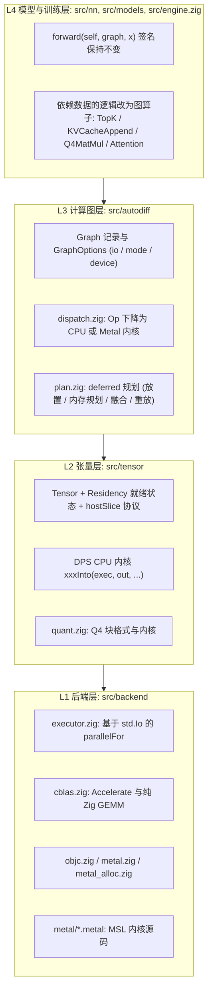
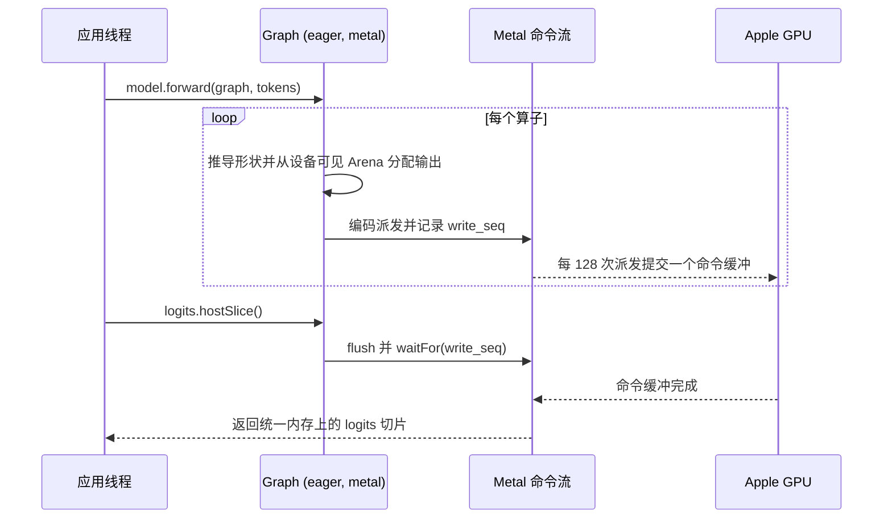
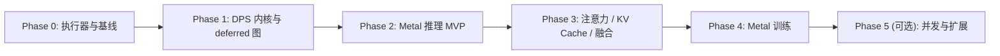

# ⚡ ZNN 异步执行与 Apple Silicon Metal 卸载设计 (Async Execution & Apple Silicon Metal Offload Design)

本文档规定 `znn` 如何从当前的“单线程同步即时执行”演进为“经 `io: std.Io` 注入并发的 CPU 执行器 + 按流有序异步执行的 Apple Silicon Metal 图形处理器 (Graphics Processing Unit, GPU) 后端”，包括关键设计决策、模块划分、核心 API、执行模型、Metal 后端细节、正确性保障与分阶段验收标准。

**平台优先级**：Apple Silicon（arm64 macOS）Metal > CPU 多核（macOS CPU 回退与 Linux）> 其他 GPU（不在本设计范围内）。

---

## 1. 目标与非目标 (Goals & Non-Goals)

### 1.1 目标
1. **Apple Silicon Metal 优先**：利用统一内存架构 (Unified Memory Architecture, UMA)，在不拷贝数据的前提下将前向推理（随后是训练）整体卸载到 GPU；Gemma 4 Q4 解码以内存带宽上限为性能标尺。
2. **并发经 `io: std.Io` 注入**：遵循 Zig 0.16 惯用法，线程池由应用创建（`std.Io.Threaded`），通过 `GraphOptions.io` 传入；库代码不自建线程、不使用全局运行时。
3. **异步但语义清晰**：设备上的算子按提交顺序执行（按流有序，stream-ordered），宿主机仅在读取张量数值时同步；不引入通用的无锁有向无环图 (Directed Acyclic Graph, DAG) 调度器。
4. **零第三方依赖**：macOS 上仅在构建期链接系统框架（`Metal`、`Foundation`、`MetalPerformanceShaders`）与 `libobjc`；Metal 着色语言 (Metal Shading Language, MSL) 源码通过 `@embedFile` 嵌入并在运行期编译，不需要 Xcode 构建期工具链。非 macOS 平台在编译期剔除 Metal 后端。
5. **正确且可复现**：CPU 并行采用与线程数无关的固定粒度分块；同一后端上 `eager` 与 `deferred` 结果逐位一致；CPU 与 Metal 之间以相对容差做一致性测试。
6. **遵守 [`AGENTS.md`](../AGENTS.md)**：配置结构体字段均有默认值并提供 `defaultOptions()` / `initDefault()`；保持文件模块化清晰与职责单一；注释中的缩写先写全称；可视化格式的生产端与消费端同步升级；不保留向后兼容层。

### 1.2 非目标（本设计范围外）
* CUDA / Vulkan / WebGPU 后端；Intel Mac（Metal 后端仅支持 arm64）。
* 逐算子代价路由 (Cost Router) 与 AMX / GPU / CPU 三方逐算子混合调度。
* 反向传播与优化器更新的流水线重叠（与 `clipGradNorm` 的全局范数语义冲突）。
* 多 GPU、自动混合精度 (Automatic Mixed Precision, AMP)（见 [`TODO.md`](TODO.md) 3.2）。

---

## 2. 现状基线 (Current Baseline, `v0.3.0`)

| 维度 | 现状 | 对本设计的影响 |
| :--- | :--- | :--- |
| 算子执行模型 | 计算与输出分配耦合：[`Graph.matmul`](../src/autodiff/graph.zig#L442-L452) → `A.matmul(B, allocator)` → 注册 Op；静态重演 [`op.forward`](../src/autodiff/op.zig#L15-L25) 依赖 `copyFromEager`（算到临时张量 → `memcpy` → 释放） | 需改造为目标传入式 (Destination-Passing Style, DPS) 内核，GPU 才能写入预分配输出 |
| Op 记录 | `enable_grad == false` 时不记录 Op（[graph.zig L290-L305](../src/autodiff/graph.zig#L290-L305)、[L328-L341](../src/autodiff/graph.zig#L328-L341)） | 无梯度推理没有可规划、可重放的图 |
| 宿主机读写 | `nn` / `models` 非测试代码在 forward 中直接读写 `.data`，如 [`MoELayer.forward`](../src/nn/transformer.zig#L344-L392) 的宿主机 Top-K、[`CausalSelfAttention.forwardInference`](../src/nn/attention.zig#L299-L359) 的 KV Cache 循环、[`generateNextTokenWithPenalty`](../src/models/gemma4.zig#L1428-L1500) 的采样 | 需要宿主访问协议，并把依赖数据的逻辑改为图算子 |
| Q4 推理线程 | [`Q4Linear.forward`](../src/models/gemma4.zig#L768-L813) 对每一行输入、每次调用 spawn 8 个 OS 线程，LM head argmax 同样如此（[L1465-L1487](../src/models/gemma4.zig#L1465-L1487)） | 128 核 Linux 虚拟机实测：spawn + join 8 线程约 **1928 µs/次**，`std.Io.Group` 派发 8 任务约 **32 µs/次** |
| Q4 内核 | 单线程 Q4 GEMV（3840×15360）约 19.7 ms（**1.7 GB/s**，受计算限制）；8 块并行 2.6 ms（12.8 GB/s）；块内低/高半字节存放相邻权重 `(2i, 2i+1)`，激活需跨步收集；多行输入逐行 GEMV，prefill 重复扫描权重 | 先优化内核与数据排布，再谈带宽上限 |
| Q4 归属 | `Q4Linear` 不是 autodiff Op；代码位于 [`gemma4.zig`](../src/models/gemma4.zig) | 下沉为张量层 `Q4MatMul` 算子并按模块职责拆分文件 |
| 注意力 | [`ScaledDotProductAttention.forwardCore`](../src/nn/attention.zig#L102-L139) 与 [`Gemma4Attention.forward`](../src/models/gemma4.zig#L317-L394) 是两套实现；后者物化 `repeatKV` 与多次转置 | 以显式 `Attention` 算子统一 |
| MoE | [`MoELayer.forward`](../src/nn/transformer.zig#L402-L410) 对所有路由专家、所有 Token 稠密计算，仅以 Top-K 掩码置零门控概率 | 稀疏 Token 分发是独立任务（Phase 3） |
| BLAS | macOS 通过 `@extern` + 构建期 `linkFramework("Accelerate")` 调用（[`cblas.zig`](../src/cblas.zig#L11-L35)），编译期按操作系统选择；Linux 为单线程纯 Zig 后备 | Accelerate 内部自行调度 AMX，不应再套一层线程 |
| 反向传播 | 梯度原地累加，如 MatMul 反向以 `beta = 1.0` 写入 `A.grad`（[backward_core.zig L22-L39](../src/autodiff/backward_core.zig#L22-L39)） | 单一有序命令流可保证安全；并发执行必须做冲突分析 |
| Zig 0.16 | `std.Thread.Pool`、`std.Thread.ResetEvent`、`std.Thread.Mutex`、`WaitGroup` 已移除，并发原语迁移到 `std.Io`（`Io.Threaded`、`Io.Group`、`Io.Event`、`Io.Mutex`、`Io.Condition`） | 执行器基于 `std.Io` 构建 |
| 解码流程 | [`examples/gemma4.zig`](../examples/gemma4.zig) 每生成一个 Token 新建无梯度图并重算整段序列（无端到端 KV Cache） | KV Cache 是 Metal 解码延迟的前置条件 |

---

## 3. 关键设计决策 (Key Design Decisions)

| 决策点 | 选择 | 理由 |
| :--- | :--- | :--- |
| 并发原语 | `std.Io`：应用创建 `std.Io.Threaded`，经 `GraphOptions.io` 注入；计算任务使用 `Io.Group.async` | Zig 0.16 惯用法；`async` 允许内联执行，嵌套并行不会死锁；库不拥有线程 |
| 执行模式 | `eager`（默认）与 `deferred` 两种 | Metal 上的 `eager` 本身就是按流有序的异步执行（类似 PyTorch 的设备流）；`deferred` 只为录制-重放、静态内存规划与融合服务；不支持“边执行边改图” |
| GPU 顺序模型 | 每个 `MetalContext` 一条有序命令流：单个 `MTLCommandQueue` + 串行派发 (`MTLDispatchTypeSerial`) 计算编码器 | 读后写 (Read-After-Write, RAW)、写后读 (Write-After-Read, WAR)、写后写 (Write-After-Write, WAW) 依赖由提交顺序天然保证，包括梯度的 `+=` 累加 |
| 设备与内核提供者 | `Device = union(enum) { cpu, metal: *MetalContext }` 表示执行流与内存域；Accelerate、Metal 性能着色器 (Metal Performance Shaders, MPS)、自研 MSL 只是内核提供者 | AMX 不是独立内存域，不作为设备 |
| 内存 | 设备可见内存通过标准 `std.mem.Allocator` 接口提供（`MetalContext.allocator()`）；`Tensor.data` 在 CPU 与 GPU 间指向同一物理内存 | 无宿主机镜像、无拷贝；模型代码只需更换分配器 |
| 放置 | 图级设备选择；Metal 不支持的算子回退到 CPU（统一内存上只需等待、无需拷贝），回退次数计入 Trace | MVP 简单可靠，避免逐算子贪心路由造成设备间乒乓 |
| 内核来源 | MSL 源码 `@embedFile` + 运行期 `newLibraryWithSource:` 编译；f32 GEMM 首选 MPS，Q4 / 归一化 / 注意力等自研 MSL | 不依赖构建期工具链；MPS 属于系统框架 |
| 宿主访问 | `hostSlice()` / `hostSliceMut()` 同步协议 + Debug 构建下对未就绪输出填充 NaN（NaN 毒化）+ CPU/Metal 一致性测试 | 不重命名全库 1,200+ 处 `.data` 访问（src 非测试 628、测试 508、示例 75），内核内部继续直接访问 `data` |
| 确定性 | 固定粒度分块（与线程数无关）+ 按块序合并的有序归约 | 跨线程数逐位一致，便于回归测试 |
| 融合 | 显式算子（`Q4MatMul`、`TopK`、`KVCacheAppend`、`Attention`）+ 执行计划层融合；逻辑 Op 图保持不变 | 求导与 Schema 2.0 导出稳定 |
| 分层 | `src/backend/` 为最底层（执行器、BLAS、Objective-C 桥接、Metal），只暴露原语内核；Op 到内核的下降 (lowering) 放在 `autodiff` | 保持 `backend ← tensor ← autodiff ← nn / models` 单向依赖；现有包级依赖已由 `zig build check-layers` 强制检查，新增 `backend` 包时在 [`tools/check_layers.zig`](../tools/check_layers.zig) 中登记为最底层 |

---

## 4. 分层架构与模块划分 (Layering & Modules)



### 4.1 新增模块（按职责保持模块化清晰）

| 路径 | 预估体积 | 职责 |
| :--- | :--- | :--- |
| `src/backend.zig` | ~2 KB | 后端门面，导出 `Executor`、`Stream`、`metal`、`cblas` |
| `src/backend/executor.zig` | ~10 KB | `Executor`（基于 `std.Io`）：`parallelFor`、`parallelReduce`、固定粒度分块、并行阈值表 |
| `src/backend/stream.zig` | ~4 KB | 设备有序命令流的类型擦除接口 `Stream`（`flush` / `waitFor` / `completedSeq`） |
| `src/backend/cblas.zig` | ~6 KB | 由 `src/cblas.zig` 迁入（同一变更中删除旧路径） |
| `src/backend/objc.zig` | ~8 KB | Objective-C 运行时最小桥接：`objc_getClass`、`sel_registerName`、强类型 `objc_msgSend`、自动释放池、`NSString` / `NSError` 辅助 |
| `src/backend/metal.zig` | ~30 KB | `MetalContext`：设备、命令队列与命令流、库编译与流水线缓存、派发编码辅助、MPS GEMM |
| `src/backend/metal_alloc.zig` | ~12 KB | `MetalAllocator`：页对齐 `mmap` 分块 + `newBufferWithBytesNoCopy` 包装、`lookup(ptr) → (MTLBuffer, offset)`、mmap 权重分段注册 |
| `src/backend/metal/*.metal` | — | MSL 源码：`elementwise`、`reduce`、`norm`、`rope`、`copy`、`q4`、`topk`、`attention` |
| `src/tensor/storage.zig` | ~6 KB | `Residency`（命令流指针、`write_seq` / `use_seq`、提交标记）与宿主访问协议实现 |
| `src/tensor/quant.zig` | ~14 KB | `Q4Block`、量化/反量化、`q4MatMulInto`（GEMV 与多行 GEMM），由 `gemma4.zig` 下沉 |
| `src/autodiff/dispatch.zig` | ~25 KB | Op 到设备内核的下降、Metal 不支持算子的 CPU 回退 |
| `src/autodiff/plan.zig` | ~20 KB | `ExecutionPlan`：迭代 Kahn 拓扑序、生命周期分析、静态内存规划、执行计划层融合、`replay` |
| `src/autodiff/trace.zig` | ~6 KB | Chrome Trace / Perfetto 时间线与计数器 |
| `src/models/gemma4_q4.zig` | ~30 KB | `Gemma4Q4*` 模型由 `gemma4.zig` 拆出 |

### 4.2 主要修改的既有模块
* [`src/autodiff/graph.zig`](../src/autodiff/graph.zig)：`GraphOptions`、`Graph.init(backing, options)` / `Graph.initDefault(backing)`（删除 `initNoGrad`，迁移约 39 处调用；约 164 处 `Graph.init(alloc)` 机械替换为 `initDefault`），`submit` / `sync` / `replay`（`replay` 取代 `Graph.forward()`），`deinit` 前同步。
* [`src/autodiff/op.zig`](../src/autodiff/op.zig)：`op.forward` 改为调用 `dispatch`，删除 `copyFromEager`。
* `src/tensor/{core,nn_kernels,conv_pool,reductions,ops}.zig`：各算子拆分为 `inferShape` 与 `xxxInto(exec, out, inputs, ctx)`；公开的分配式张量 API（如 `Tensor.matmul(other, allocator)`）改为“分配输出 + 调用 `xxxInto(.serial, ...)`”，不保留重复实现。
* [`src/nn/transformer.zig`](../src/nn/transformer.zig)、[`src/nn/attention.zig`](../src/nn/attention.zig)、[`src/models/gemma4.zig`](../src/models/gemma4.zig)：宿主机 Top-K、KV Cache 写入与采样改为图算子或显式同步点。
* [`build.zig`](../build.zig)：macOS 上链接 `Metal` / `Foundation` / `MetalPerformanceShaders` 与 `objc`；新增 `-Dmetal`、`-Dtsan` 选项与 `test-metal` 步骤。
* [`src/bench/suites.zig`](../src/bench/suites.zig)：新增 `executor`、`q4`、`decode`、`metal` 基准套件。
* [`src/autodiff/backward_nn.zig`](../src/autodiff/backward_nn.zig) 已有 58,473 B：新增反向内核放入独立文件（如 `backward_attention.zig`）。

---

## 5. 核心 API (Core APIs)

### 5.1 执行器 (`src/backend/executor.zig`)

```zig
/// 基于 Zig 0.16 输入输出接口 (Input/Output, Io) 的数据并行执行器 (Executor)。
/// 库本身不创建线程：线程池由应用创建 (`std.Io.Threaded`) 并经 `GraphOptions.io` 注入。
pub const Executor = struct {
    io: ?std.Io = null, // null 表示串行执行
    max_tasks: ?usize = null, // null 表示使用逻辑核心数

    pub const serial: Executor = .{};

    /// 将区间 [0, n) 按固定粒度 `grain` 切块并行调用 `body(ctx, begin, end)`。
    /// 块边界只取决于 n 与 grain（与线程数无关），因此结果跨线程数逐位可复现。
    pub fn parallelFor(
        self: Executor,
        n: usize,
        grain: usize,
        ctx: anytype,
        comptime body: fn (@TypeOf(ctx), usize, usize) void,
    ) std.Io.Cancelable!void { ... }

    /// 有序归约：每块写入 `partials[chunk]`，由调用线程按块序合并，保证确定性。
    pub fn parallelReduce(...) std.Io.Cancelable!void { ... }
};
```

实现要点：
1. `chunks = ceil(n / grain)`；`io == null` 或 `chunks == 1` 时直接内联执行。
2. `tasks = min(chunks, max_tasks orelse 逻辑核心数)`；共享原子计数器 `next` 动态领取块，调用线程同样参与计算，通过 `Io.Group.async` 派发其余 `tasks - 1` 个任务，最后 `group.await(io)`。
3. 动态领取 + 块数约为任务数的 4~8 倍，避免 Apple Silicon 性能核 (P-core) 等待能效核 (E-core)。
4. 并行阈值：本机实测常驻池派发 8 任务约 32 µs，因此单线程耗时低于约 0.3 ms 的工作不并行；各内核的 `grain` 与阈值由 `just bench --suite executor` 标定后写入阈值表。
5. Accelerate 与 MPS 调用不包进 `parallelFor`，避免线程超额订阅。

### 5.2 计算图配置与入口 (`src/autodiff/graph.zig`)

```zig
/// 计算图执行模式
pub const ExecutionMode = enum {
    /// 即时模式（默认）：算子在记录时立即派发；CPU 上同步完成，Metal 上按流有序异步执行
    eager,
    /// 延迟模式：只记录算子，`submit` 时统一规划（放置、内存规划、融合）后派发，可 `replay` 重放
    deferred,
};

/// 计算图的执行设备
pub const Device = union(enum) {
    cpu,
    metal: *backend.metal.MetalContext,
};

/// 计算图配置（遵循 AGENTS.md §4：所有字段均有默认值）
pub const GraphOptions = struct {
    io: ?std.Io = null, // 由应用注入的输入输出接口；null 表示串行执行
    enable_grad: bool = true,
    mode: ExecutionMode = .eager,
    device: Device = .cpu,
    max_tasks: ?usize = null,
    trace: ?*Trace = null,

    pub const default: GraphOptions = .{};
    pub fn defaultOptions() GraphOptions {
        return .{};
    }
};
```

| 方法 | 行为 |
| :--- | :--- |
| `Graph.init(backing, options: GraphOptions) Graph` | 唯一的完整入口；设备为 Metal 时张量缓冲区来自 `MetalContext.allocator()`，图元数据仍使用 `backing` |
| `Graph.initDefault(backing) Graph` | 等价于 `Graph.init(backing, .{})` |
| `graph.submit(targets: []const *Tensor) !void` | `deferred`：规划并派发 `targets` 依赖的子图；`eager`：提交当前命令缓冲 |
| `graph.sync() !void` | 等待已提交的全部工作完成 |
| `graph.replay() !void` | 按已有执行计划用当前输入重新执行（取代 `Graph.forward()`） |
| `graph.deinit()` | 先 `sync()` 再释放 Arena |

**Op 记录规则**：当 `enable_grad`、`mode == .deferred` 或 `device != .cpu` 任一成立时记录 Op；`enable_grad` 只决定是否分配梯度缓冲与执行反向传播。

### 5.3 张量就绪状态与宿主访问协议 (`src/tensor/storage.zig`)

```zig
/// 张量缓冲区在设备命令流上的驻留与就绪状态 (Residency)
pub const Residency = struct {
    stream: ?*backend.Stream = null, // 最近访问该缓冲区的设备命令流；null 表示宿主机可直接访问
    write_seq: u64 = 0, // 最近一次写入该缓冲区的命令缓冲序号
    use_seq: u64 = 0, // 最近一次读取或写入该缓冲区的命令缓冲序号
    submitted: bool = true, // deferred 模式下尚未提交的输出为 false
};
```

`Tensor` 新增 `residency: Residency = .{}` 与 `base: ?*Tensor = null`（零拷贝视图通过 `base` 共享基张量的就绪状态），并提供：

| 方法 | 行为 |
| :--- | :--- |
| `hostSlice(self) ![]f32` | 等待 `write_seq` 完成后返回逻辑元素切片（要求连续，非连续视图先 `contiguous()`）；deferred 模式下未提交返回 `error.TensorNotSubmitted` |
| `hostSliceMut(self) ![]f32` | 等待 `use_seq` 完成（排除 WAR 冲突）后返回可写切片 |
| `item(self) !f32` | 标量读取（内部调用 `hostSlice`） |
| `isReady(self) bool` | 非阻塞查询 |

* **适用范围**：内核内部继续直接访问 `data`；`nn` / `models` / `engine` / 示例中在内核执行之外读写数值的位置（逐处审计 `nn` / `models` 非测试代码 107 处、`engine.zig` 11 处与示例 75 处 `.data` 访问）以及运行于 deferred / Metal 的测试迁移到该协议。
* **NaN 毒化**：Debug 构建下，deferred / Metal 模式的新输出缓冲先填充 NaN，任何过早的 `.data` 读取都会在一致性测试中显现为 NaN。

### 5.4 Metal 上下文 (`src/backend/metal.zig`)

```zig
/// Apple Silicon Metal 执行上下文：设备、命令流、内核库与设备可见内存
pub const MetalContext = struct {
    pub const Options = struct {
        chunk_bytes: usize = 64 << 20, // 统一内存分块大小（按 16 KB 页对齐）
        max_dispatches_per_command_buffer: u32 = 128, // 达到后提交命令缓冲，让 GPU 尽早开始执行
        safe_math: bool = true, // 关闭快速数学，保证与 CPU 结果一致

        pub fn defaultOptions() Options {
            return .{};
        }
    };

    pub fn init(gpa: std.mem.Allocator, options: Options) !MetalContext { ... }
    pub fn initDefault(gpa: std.mem.Allocator) !MetalContext { ... }
    pub fn deinit(self: *MetalContext) void { ... }
    /// 设备可见（统一内存零拷贝）分配器：经它分配的张量可被 GPU 直接访问
    pub fn allocator(self: *MetalContext) std.mem.Allocator { ... }
    /// 注册 mmap 映射的权重文件（按 maxBufferLength 分段）
    pub fn registerMapped(self: *MetalContext, bytes: []align(std.heap.page_size_min) const u8) !void { ... }
    pub fn stream(self: *MetalContext) *backend.Stream { ... }
};
```

应用侧用法：

```zig
var threaded: std.Io.Threaded = .init(gpa, .{});
defer threaded.deinit();
var metal = try znn.backend.metal.MetalContext.initDefault(gpa);
defer metal.deinit();

// 模型参数与 KV Cache 使用设备可见分配器，GPU 可零拷贝访问
var model = try Model.init(metal.allocator(), .{});
defer model.deinit(metal.allocator());

var graph = znn.autodiff.Graph.init(gpa, .{
    .io = threaded.io(),
    .enable_grad = false,
    .device = .{ .metal = &metal },
});
defer graph.deinit();

const logits = try model.forward(&graph, tokens);
const host_logits = try logits.hostSlice(); // 唯一同步点：统一内存上零拷贝读取
```

---

## 6. 执行模型 (Execution Model)

### 6.1 eager 模式
* **CPU**：按记录规则记录 Op → 从图 Arena 分配输出 → `xxxInto(exec, out, ...)` 内联执行（可在算子内并行），语义与当前一致。
* **Metal**：记录 Op → 从设备可见 Arena 分配输出 → 编码一次派发到当前命令缓冲（串行派发编码器）→ 更新输出的 `write_seq` 与输入的 `use_seq` → 立即返回。命令缓冲在派发数达到 `max_dispatches_per_command_buffer`、遇到同步点或 `graph.sync()` 时提交。



### 6.2 deferred 模式
1. forward / backward 只记录 Op 并推导形状，Op 输出缓冲暂不分配（`submitted = false`）；图构建代码直接创建并在宿主机写入的常量张量（如因果掩码）立即分配，视为已就绪。
2. `graph.submit(targets)`：迭代 Kahn 算法求拓扑序 → 生命周期分析 → 放置（设备与 CPU 回退片段）→ 静态内存规划（生命周期区间映射为单块 Arena 内的偏移）→ 执行计划层融合（Phase 3）→ 依序派发。
3. `graph.replay()`：输入经 `hostSliceMut()` 原地更新后重放同一执行计划，复用内存规划；适用于形状固定的训练步与解码步。
4. 依赖数据的宿主逻辑（如尚未改造的 MoE 路由）在 deferred 模式下会得到 `error.TensorNotSubmitted`，问题会被显式暴露，不会静默读到错误数据。

### 6.3 Metal 设备上的 CPU 回退
对没有 Metal 内核的算子：等待输入的 `write_seq` → 在同一块统一内存上执行 CPU 内核 → 输出立即可被后续 GPU 派发读取（GPU 在命令缓冲提交时可见共享存储上的 CPU 写入）。每次回退都会产生一次 GPU → CPU → GPU 气泡，记入 Trace 计数器。

### 6.4 同步点
`hostSlice` / `hostSliceMut` / `item`；`graph.sync` / `graph.submit`（eager 下为提交）/ `graph.deinit`；CPU 回退；参数位于设备时的 `optimizer.step`（Phase 4 前为同步点）；采样与日志输出。

### 6.5 错误传播与取消
* 命令缓冲状态为 `error` 时，命令流进入失败状态，之后所有 `waitFor` 返回 `error.DeviceExecutionFailed`（同时记录 `NSError` 描述），该图只能 `deinit`。
* CPU 内核错误在派发时（eager）或 `submit` 时（deferred）同步返回；`parallelFor` 的 `error.Canceled` 原样向上传播。

### 6.6 分配器要求
`io != null` 时图的 backing 分配器必须线程安全（Zig 0.16 的 `ArenaAllocator` 仅在子分配器线程安全时线程安全，`std.heap.smp_allocator` / `DebugAllocator` 满足）；`MetalContext.allocator()` 内部加锁，线程安全。

---

## 7. Apple Silicon Metal 后端详细设计

### 7.1 Objective-C 运行时桥接 (`src/backend/objc.zig`)
* 通过 `objc_getClass`、`sel_registerName` 与按方法签名强类型转换的 `objc_msgSend` 调用 Metal / Foundation / MPS。arm64 上 `objc_msgSend` 不是可变参数函数，必须按确切签名转换；arm64 不需要 `objc_msgSend_stret`；`MTLSize` 等结构体按 C 调用约定按值传递。
* 每个消息封装为具名 Zig 函数（集中管理签名，避免选择子拼写错误导致运行期崩溃）。
* 编码与提交路径包裹在 `objc_autoreleasePoolPush` / `objc_autoreleasePoolPop` 中；遵守所有权规则：`new` / `alloc` / `copy` 返回的对象由我们负责 `release`，其余为自动释放对象。
* 仅在 `builtin.os.tag == .macos and builtin.cpu.arch == .aarch64` 时编译；其他平台在编译期剔除（与当前 Accelerate 的处理方式一致）。

### 7.2 统一内存与缓冲区管理 (`src/backend/metal_alloc.zig`)
* **分块**：匿名 `mmap` 申请 `chunk_bytes`（默认 64 MB，Apple Silicon 页大小 16 KB，长度向上取整到页），通过 `newBufferWithBytesNoCopy:length:options:deallocator:`（`MTLResourceStorageModeShared`，`deallocator` 传 `nil`，`MTLBuffer` 释放后由我们 `munmap`）包装为一个 `MTLBuffer`。官方文档要求起始地址与长度均页对齐，且内存来自 `vm_allocate` / `mmap` 的单一虚拟内存区域（不允许 `malloc` 分配）。
* **子分配**：块内用空闲链表做子分配；超过块大小的请求使用独立映射。`lookup(ptr)` 在按地址排序的块表上二分查找，得到 `(MTLBuffer, offset)`，派发时通过 `setBuffer:offset:atIndex:` 绑定。
* **mmap 权重**：Gemma Q4 权重文件经 `registerMapped` 注册，按设备 `maxBufferLength` 分段，相邻段重叠不少于最大单张量字节数，保证每个张量完整落在某一段内（ggml-metal 的成熟做法）。
* **非设备可见输入**：通过普通分配器分配的输入张量先拷贝到图 Arena 的暂存缓冲，Debug 构建下打印一次警告。
* **驻留优化**：macOS 15+ 可选用 `MTLResidencySet` 降低大量缓冲的绑定开销（后续优化）。

### 7.3 命令流、编码与同步
* 每个 `MetalContext` 持有一个 `MTLCommandQueue`，即一条 `Stream`：维护 `submitted_seq`，以及在途命令缓冲的环形队列。
* 当前命令缓冲上保持一个串行派发计算编码器；小参数用 `setBytes:length:atIndex:`（≤ 4 KB），缓冲用 `setBuffer:offset:atIndex:`；派发使用 `dispatchThreads:threadsPerThreadgroup:`（Apple GPU 支持非均匀线程组）。
* 等待：对序号不小于目标 `seq` 的命令缓冲调用 `waitUntilCompleted`；`isReady` 查询其 `status`。不使用 Objective-C Block（完成回调），桥接更简单。
* 编码开销：每次派发约数微秒（Phase 2 标定）。Gemma 4 12B 每生成一个 Token 约 1.4k 次派发，依靠提交批处理、融合与 Phase 5 的间接命令缓冲重放控制主机开销。

### 7.4 内核库
* `src/backend/metal/*.metal` 经 `@embedFile` 拼接，在 `MetalContext.init` 时以 `newLibraryWithSource:options:error:` 编译一次（`safe_math = true` 时关闭快速数学）；按“内核名 + 函数常量”缓存 `MTLComputePipelineState`；编译错误连同 `NSError` 文本返回。
* MVP 内核清单（激活为 f32）：

| 类别 | 内核 | 对应 OpType |
| :--- | :--- | :--- |
| 逐元素一元 / 标量 | relu、gelu、silu、sigmoid、tanh、exp、log、sqrt、abs；标量加减乘除 | `Relu`、`Gelu`、`Silu`、`Sigmoid`、`Tanh`、`Exp`、`Log`、`Sqrt`、`Abs`、`AddScalar` 等 |
| 二元广播 | add、sub、mul、div（连续快速路径 + 通用跨步路径） | `Add`、`Sub`、`Mul`、`Div` |
| 归约 | 行内 sum、mean、max、argmax；行内 softmax | `Sum`、`Mean`、`Softmax` |
| 归一化 | rmsnorm（含 Gemma 的 `1 + w` 缩放）、layernorm | `RmsNorm`、`LayerNorm` |
| 位置编码 | rope（interleaved / split-half / partial） | `RoPE` |
| 数据搬运 | 跨步拷贝（transpose、contiguous、slice、concat、split、repeatKV）、embedding 查表（f32 / bf16） | `Transpose`、`Reshape`、`Slice`、`Concat`、`Split`、`RepeatKV` |
| 矩阵乘 | f32：MPS `MPSMatrixMultiplication`；Q4：GEMV（解码）与 simdgroup 矩阵 GEMM（prefill） | `MatMul`、`BatchMatMul`、`Q4MatMul` |
| 路由与缓存 | Top-K、KV Cache 追加写入 | `TopK`、`KVCacheAppend` |

* Q4 与注意力内核参考 ggml-metal（`kernel_mul_mv_q4_0_f32`、`kernel_mul_mm_q4_0_f32` 与 flash attention 系列）的分块与访存模式。

### 7.5 Q4 块内数据排布
现有 `Q4Block`（f16 缩放 + 16 字节半字节，共 18 B / 32 权重）把相邻权重 `(2i, 2i+1)` 存入同一字节，CPU 内核需对激活做跨步收集。Phase 0 将块内排布改为 split-half（低半字节存 `j`、高半字节存 `j + 16`，与 ggml Q4_0 相同），使 CPU SIMD 与 Metal 内核都能连续加载激活。量化工具 [`tools/quantize_gemma4.zig`](../tools/quantize_gemma4.zig) 与加载器同步升级，文件魔数由 `ZNNQ4G01` 提升为 `ZNNQ4G02`（不保留旧格式读取分支）。

### 7.6 构建、测试与基准
* `build.zig`：`-Dmetal`（aarch64-macos 默认开启，其他平台不可用）；链接 `Metal`、`Foundation`、`MetalPerformanceShaders` 与 `objc`；`zig build test` 中的 Metal 测试在非 macOS 上返回 `error.SkipZigTest`；新增 `zig build test-metal` 与 `just test-metal`。
* **一致性测试**：同一张图分别在 CPU 与 Metal 上执行，f32、安全数学下要求 `rtol = 1e-4`、`atol = 1e-5`。
* **基准**：`executor`（派发开销与扩展效率）、`q4`（CPU / Metal 的 GEMV、GEMM，单位 GB/s）、`decode`（TinyGemma4 与 Gemma4Q4 单步）、`metal`（拷贝带宽基线与编码开销）。
* 仓库暂无持续集成 (Continuous Integration, CI)：Metal 相关验证在本地 Apple Silicon Mac 上执行，结果记录在基准输出中；Linux 只跑 CPU 测试。

---

## 8. CPU 执行器与算子内并行
* **按行并行**：softmax、rmsnorm、layernorm、rope 与大张量逐元素算子按行或按块调用 `parallelFor`。
* **Q4**：GEMV 按输出行切块；多行输入使用 Q4 GEMM（行 × 列分块，复用已加载的权重块），消除 prefill 中权重被重复扫描的问题；LM head argmax 按块求局部最大值后有序合并。
* **卷积反向**：`dW` 沿 batch 归约、`col2im` 在 stride 小于卷积核时散射写入会重叠，因此采用“每块私有部分和 + 有序归约”。
* **GEMM**：macOS 直接调用 Accelerate；Linux 的寄存器 / 缓存分块微内核与 `-Dblas=openblas` 推迟到 Phase 5。

---

## 9. 正确性保障 (Correctness)
* **冲突依赖**：CPU eager 顺序执行；Metal 的单命令队列 + 串行派发保证所有 RAW / WAR / WAW 依赖（含梯度累加）按提交顺序满足；宿主访问通过 `write_seq` / `use_seq` 等待；CPU 回退等待输入就绪。
* **并发扩展的前提（Phase 5）**：Metal 并发派发与 CPU 算子间并行都必须基于缓冲区级冲突分析插入屏障；对同一梯度缓冲的多个写者按固定顺序串成链（同时保证确定性）；缓冲区版本号与 [`TODO.md`](TODO.md) 3.2 的计算图版本计数器统一为一套机制。
* **确定性**：固定粒度分块 + 有序归约；CPU 上 eager 与 deferred 逐位一致；`io = null` 与 `io = threaded` 逐位一致。
* **优化器**：`optimizer.step` 在反向完成后按流顺序执行，`clipGradNorm` 的全局范数语义保持不变。
* **生命周期**：`graph.deinit()` 先同步再释放 Arena；`MetalContext.deinit()` 先等待命令流排空。

---

## 10. 内存规划、显式算子与融合
* **静态内存规划**：deferred 模式按生命周期区间为中间激活分配偏移，`replay` 复用同一规划；无梯度推理的激活峰值从全部中间结果之和降至同时存活集合的上界。
* **显式算子**：
  * `Q4MatMul`（Phase 0，仅推理，反向返回 `error.UnsupportedBackward`）；
  * `TopK`、`KVCacheAppend`（Phase 1）；
  * `Attention`（Phase 3）：`AttentionOptions = { scale, causal, sliding_window, softcap, kv_groups }`，原生支持分组查询注意力 (Grouped-Query Attention, GQA)，直接接收 `[B, T, H, D]` 跨步输入，免去 `repeatKV` 物化与转置；由 `ScaledDotProductAttention`、`Gemma4Attention`、`Gemma4Q4Attention` 共用。
* **权重融合**：加载时拼接 QKV 投影与 gate / up 投影，一次大 GEMM 替代多次小 GEMM。
* **执行计划层融合**：逐元素链、残差加法 + RMSNorm、GEMM 尾部（偏置 + 激活），只作用于 `ExecutionPlan`，逻辑 Op 图不变。
* **Schema 同步**：新增 `OpType` 时，在同一变更中更新 [`model_graph.schema.json`](../src/nn/model_graph.schema.json) 枚举，重新生成 `examples/` 下的模型图，并更新 `web/` 测试与可视化文档（AGENTS.md §3）。

---

## 11. 可观测性 (Observability)
* `GraphOptions.trace` 指向 `Trace` 时，导出 Chrome Trace / Perfetto 时间线：CPU 内核与执行器任务区间、Metal 命令缓冲（`GPUStartTime` / `GPUEndTime`）、同步等待、CPU 回退。
* 计数器：派发次数、命令缓冲数、同步次数、回退算子数、设备内存分配量。

---

## 12. 分阶段路线图与验收标准 (Roadmap & Acceptance)



### Phase 0（`v0.3.x`）：执行器与基线 [已完成]
* **开发内容**：
  1. [x] `src/backend/executor.zig`（基于 `std.Io` 的 `parallelFor` / `parallelReduce`）；`GraphOptions` 与 `Graph.init(backing, options)` / `Graph.initDefault`，删除 `initNoGrad` 并迁移全部调用方；
  2. [x] 用执行器替换 `Q4Linear.forward` 与 LM head argmax 中每次调用 spawn 线程的实现；
  3. [x] 拆分 `gemma4.zig`：`Q4Block` 与内核下沉为 `src/tensor/quant.zig`，Q4 模型拆为 `src/models/gemma4_q4.zig`，新增 `Q4MatMul` 算子并经 `Graph` 记录；
  4. [x] Q4 split-half 块内排布 + 文件魔数 `ZNNQ4G02`，量化工具与加载器同步升级；
  5. [x] `src/cblas.zig` 迁入 `src/backend/cblas.zig`，并在 `tools/check_layers.zig` 中以 `backend` 包（层级 0）替换 `cblas`；
  6. [x] 新增 `executor`、`q4`、`decode` 基准并记录基线。
* **验收结果**（以下数据均在同一台 128 核 Linux 虚拟机上以 `-Doptimize=ReleaseFast` 测得）：
  * `zig build test` 全部通过（192/192），模块职责边界清晰；
  * 热路径中彻底移除 `std.Thread.spawn`；`Graph.q4MatMul`（`Q4Linear.forward` 的实际路径）经 `graph.executor()` 并行；
  * Q4 矩阵乘在 `io = null`（串行）与 `io = threaded`（多核）下逐位一致，多行输入中每一行也与单行计算逐位一致；
  * Gemma 4 12B MLP 形状（3840×15360，权重 33 MB）：单线程由 v0.3.0 的 19.7 ms（1.7 GB/s）降至约 11.6 ms（2.8 GB/s）；用满全部核心约 0.9–1.2 ms（28–36 GB/s）；多行输入 T=4 / 16 / 64 分别约 1.3 / 2.8 / 7.4 ms；
  * `q4` 基准（2048×2048）：串行 0.84 ms，4 线程 0.29 ms，经 `Graph.q4MatMul` 4 线程 0.28 ms，16 行批量 4 线程 2.05 ms；
  * `decode` 基准：`TinyGemma4` 0.037 ms/step（约 27.0k tokens/s），`TinyQ4Gemma4` 0.035 ms/step（约 28.8k tokens/s），`TinyQ4Gemma4` T=16 预填充 0.215 ms。
  * 同时落地第 8 节中的 Q4 多行分块：16 路向量解包与（8 行 × 128 列）二维分块，分块内复用已解包的权重块。

### Phase 1（`v0.4.0`）：DPS 内核与 deferred 图（CPU）
* **开发内容**：
  1. 全部 `OpType` 拆分为 `inferShape` + `xxxInto`，`op.forward` 改为调用 `dispatch`（删除 `copyFromEager`）；实施 Op 记录规则；
  2. `Residency` 与 `hostSlice` / `hostSliceMut` / `item` / `isReady`，迁移 `nn` / `models` / `engine` / 示例中的宿主访问；
  3. `TopK`（MoE 路由）与 `KVCacheAppend` 算子，`forwardInference` 改为基于图的实现；
  4. deferred 模式：`submit` / `sync` / `replay`（取代 `Graph.forward()`）与静态内存规划；
  5. 按行并行的 CPU 内核；Debug NaN 毒化；Trace（CPU 部分）。
* **验收标准**：
  * 全量测试在 eager 与 deferred 两种模式下通过（参数化测试辅助函数）；
  * CPU 上 eager 与 deferred 结果逐位一致；
  * `zig build run-report` 与 `zig build run-book-models` 的导出结果只按新增 `OpType` 发生预期变化，并按 AGENTS.md §3 同步。

### Phase 2（`v0.4.x`）：Metal 推理后端 MVP
* **开发内容**：
  1. `objc.zig`、`metal.zig`、`metal_alloc.zig`、`stream.zig`；
  2. 第 7.4 节 MVP 内核清单（MPS f32 GEMM + 自研 MSL）；
  3. CPU 回退与回退计数；`-Dmetal`、`test-metal` 与 `metal` 基准；
  4. TinyGemma4 / TinyQ4Gemma4 / GPT 及 Gemma 4 12B Q4 在 Metal 上完成前向。
* **验收标准**：
  * MVP 算子与 Tiny 模型的 CPU / Metal 一致性满足 `rtol = 1e-4`、`atol = 1e-5`；
  * Metal Q4 GEMV 达到实测 Metal 拷贝带宽的 70% 以上；
  * Gemma4Q4 单步前向 Trace 中 CPU 回退为 0，宿主等待仅发生在读取 logits 时；
  * Linux 构建与测试不受影响。

### Phase 3（`v0.5.0`）：注意力、KV Cache 与融合
* **开发内容**：
  1. `Attention` 算子：CPU 分块在线 Softmax、Metal flash attention（prefill）与解码专用内核，三处注意力实现统一使用该算子；
  2. Gemma4 / Gemma4Q4 / GPT 端到端 KV Cache（解码步 `T = 1`）；
  3. QKV 与 gate / up 权重融合；执行计划层融合；
  4. MoE 稀疏 Token 分发（`TopK` + gather / scatter-add，固定容量填充以获得静态形状）；
  5. 可选：LM head 量化（bf16 共享词嵌入每 Token 约 2.0 GB，Q8 / Q4 可降至约 1.07 / 0.57 GB）。
* **验收标准**：
  * Gemma 4 12B Q4 在测试 Mac 上的解码速度不低于带宽上限的 60%。每 Token 约读取 8 GB（Q4 层权重约 6.1 GB + bf16 LM head 约 2.0 GB），例如 400 GB/s 机型上限约 49 tokens/s，目标不低于 30 tokens/s；
  * `T >= 4096` 的 prefill 注意力内存为 $O(T)$；
  * 融合前后输出一致。

### Phase 4（`v0.5.x`）：Metal 训练
* **开发内容**：常用算子的 Metal 反向内核（GEMM 转置、逐元素、softmax / norm / rope 伴随、带重计算的注意力反向、基于 im2col + GEMM 的卷积）；SGD / Adam / AdamW 优化器内核；GPU 归约实现的 `clipGradNorm`；`zeroGrad` 内核。
* **验收标准**：
  * MLP / CNN / mini-GPT 在 Metal 上训练 N 步的损失曲线与 CPU 相对误差 ≤ 1e-3；
  * 报告相对 CPU（Accelerate）的吞吐提升；
  * 训练步内除读取 loss 外无宿主等待。

### Phase 5（可选）：并发与扩展
* Metal 并发派发（`MTLDispatchTypeConcurrent`），基于缓冲区冲突分析插入内存屏障；多命令缓冲并行编码；解码步使用间接命令缓冲 (`MTLIndirectCommandBuffer`) 重放。
* CPU 算子间并行（迭代 Kahn 波前 + 冲突跟踪 + 梯度写者链），仅在 Trace 显示核心空闲时实施。
* Linux GEMM 微内核与 `-Dblas=openblas`；其他 GPU 后端评估。

---

## 13. 风险与待验证事项 (Risks & Open Items)

| 风险 | 影响 | 缓解措施 |
| :--- | :--- | :--- |
| Zig 0.16 `std.Io` API 仍在演进 | 执行器接口随版本变动 | 执行器作为薄封装，隔离 `std.Io` 细节 |
| Objective-C 桥接 ABI 错误 | 运行期崩溃 | 每个消息封装为强类型函数，并配 macOS 单元测试 |
| `maxBufferLength` 限制 | 大权重无法整段包装 | 分段注册（相邻段重叠） |
| MPS 对偏移、跨步与转置的约束 | f32 GEMM 不可用或需额外拷贝 | Phase 2 开始前先做技术验证 (spike)；不满足时改用自研 simdgroup GEMM |
| MSL 运行期编译耗时（数百毫秒） | 启动变慢 | 每个上下文只编译一次；后续可用 `MTLBinaryArchive` 缓存 |
| GPU f32 数值差异 | 一致性测试误报 | 安全数学 + 相对容差策略 |
| 16 GB 内存机型 | 12B Q4 权重约 8 GB（含 bf16 词嵌入）+ KV Cache + 激活 | 内存预算检查；KV Cache 后续支持 f16 |
| 宿主访问遗漏 | 读到未就绪数据 | NaN 毒化 + 一致性测试 + deferred 下的 `error.TensorNotSubmitted` |
| 每 Token 派发编码开销 | 主机侧成为瓶颈 | 提交批处理、融合、间接命令缓冲重放 |
| 无持续集成 | Metal 回归难以及时发现 | `just test-metal` 本地验证；基准结果随提交记录 |
