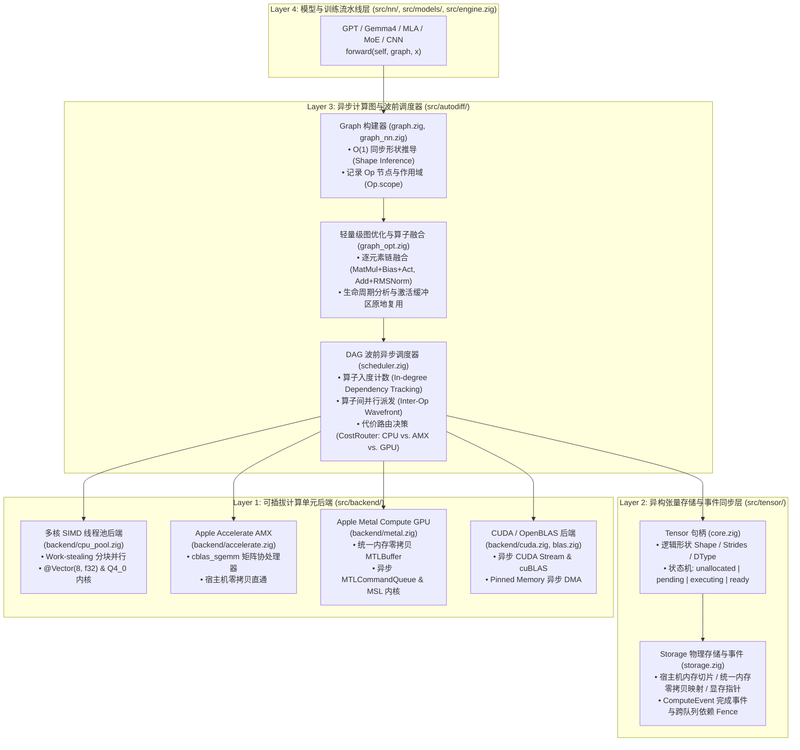
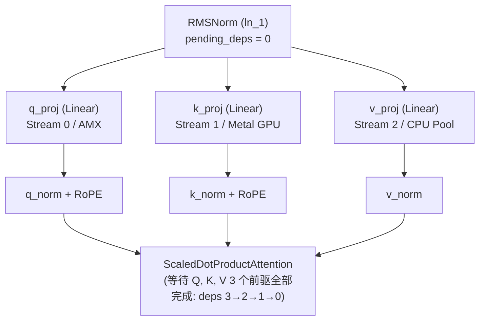

# ⚡ ZNN 异步计算图与异构计算单元卸载设计规划 (Async Execution & Hardware Offload Design)

本文档定义 `znn` 从当前的“单线程同步即时执行（Synchronous Eager Execution）”演进为**“全链路异步计算图 + 异构计算单元卸载（Asynchronous DAG Scheduling & Heterogeneous Compute Offload）”**的系统架构与分阶段工程实现规范。

---

## 1. 设计目标与核心原则 (Design Goals & Principles)

1. **上层模型代码零侵入 (Zero Model-Code Intrusion)**：
   保持 [`src/nn/`](../src/nn.zig) 与 [`src/models/`](../src/models.zig) 中所有模块的 `forward(self, graph: *autodiff.Graph, x, ...)` 签名与调用方式完全不变。主线程在 `forward` 中仅执行 $O(1)$ 的形状推导（Shape Inference）与算子有向无环图（Directed Acyclic Graph, DAG）节点注册，将耗时数值计算无缝交由后台异步调度器与硬件加速后端执行。
2. **全链路异步与按需同步 (End-to-End Asynchrony & Lazy Synchronization)**：
   算子提交（Dispatch）与算子执行（Execution）彻底解耦。CPU 主线程无需等待前一层计算完成即可继续构建后续层，仅在宿主机显式读取张量数值（如 `loss.item()`、Token 采样、日志打印或权重序列化）时触发精确的同步屏障（Synchronization Barrier）。
3. **算子级异构计算卸载 (Operator-Level Heterogeneous Offload)**：
   依据算子的计算密度（Arithmetic Intensity）与张量规模，由代价路由模型（Cost Router）自动将重负载算子（`MatMul`、`BatchMatMul`、`Q4Linear` 4-bit 反量化矩阵乘、`Conv1D/2D`、`FlashAttention`）卸载至专用计算单元（Apple Silicon AMX 协处理器、Apple Metal GPU、NVIDIA CUDA TensorCore、多核 SIMD 线程池），将控制流与极小张量保留在宿主机 CPU 缓存内执行。
4. **零外部编译期强依赖 (Zero Mandatory Compile-Time Dependencies)**：
   延续 [`src/cblas.zig`](../src/cblas.zig) 的设计哲学，所有外部硬件驱动与加速库（macOS `Metal.framework`、Linux `libcuda.so` / `libcublas.so`、`libopenblas.so`）均通过 `std.DynLib` 运行期动态按需加载或通过 `build.zig` 的可选编译参数开启，并始终提供 100% 纯 Zig 编写的多核单指令多数据流（Single Instruction, Multiple Data, SIMD）后备实现。
5. **严格遵循仓库规范 ([`AGENTS.md`](../AGENTS.md))**：
   所有新增配置结构体（`GraphOptions`、`DeviceOptions`、`SchedulerOptions`）均提供合理的字段默认值（支持 `.{}` 构造）及 `defaultOptions()`；每个非测试源码文件严格保持在 `< 60 KB` 以内；源码注释中首次出现专业缩写时均先写全称再接括号缩写。

---

## 2. 系统分层架构蓝图 (System Architecture Blueprint)

`znn` 现有的单向分层依赖（[`Tensor`](../src/tensor/core.zig) ← [`autodiff.Graph`](../src/autodiff/graph.zig) ← [`nn`](../src/nn.zig) / [`models`](../src/models.zig)）与 [`Graph.topologicalSortOps`](../src/autodiff/graph.zig) 算子级拓扑排序，天然具备演进为异步任务图与异构后端的底座。升级后的四层架构如下：



### 模块化文件拆分规划（单文件严格 `< 60 KB`）

| 新增 / 演进模块路径 | 预估体积 | 核心职责 |
| :--- | :--- | :--- |
| `src/tensor/storage.zig` | ~18 KB | `Device`、`DeviceType`、`TensorState`、`ComputeEvent`（跨线程/跨设备同步原语）、`StorageBuffer`（宿主机内存、页对齐统一内存、独立显存句柄管理）。 |
| `src/autodiff/scheduler.zig` | ~25 KB | `AsyncScheduler`、`WavefrontNode`（原子入度计数与后继唤醒）、前向与反向 DAG 异步波前执行器、基于生命周期的临时激活内存池复用。 |
| `src/autodiff/graph_opt.zig` | ~20 KB | 惰性计算图提交前的轻量级优化 Pass：算子融合（Operator Fusion）、死代码消除（Dead-Node Elimination）与设备亲和性放置（Device Placement）。 |
| `src/backend/backend.zig` | ~15 KB | `ComputeBackend` 统一虚表接口（VTable）、`CostRouter` 算子卸载代价评估模型、后端注册与设备发现。 |
| `src/backend/cpu_pool.zig` | ~24 KB | 纯 Zig 多核分块并行执行器（基于 `std.Thread.Pool`）：2D 矩阵乘法分块、4-bit `Q4_0` 矩阵向量乘行分块、卷积 `im2col` 与归一化多线程加速。 |
| `src/backend/metal.zig` | ~32 KB | macOS Apple Silicon Metal Compute 异步后端：基于 `MTLResourceStorageModeShared` 的零拷贝统一内存、`MTLCommandQueue` 异步提交与预编译 MSL 算子库。 |
| `src/backend/cuda.zig` | ~28 KB | Linux/Windows NVIDIA GPU 异步后端：`std.DynLib` 动态加载 `libcuda` / `libcublas`、异步 `cudaStream_t` 队列与锁页内存（Pinned Memory）DMA 传输。 |

---

## 3. 核心数据结构与异步 API 设计 (Core Data Structures & Zig APIs)

### 3.1 设备、物理存储与同步事件 (`src/tensor/storage.zig`)

当前 [`Tensor`](../src/tensor/core.zig) 在构造时立即分配宿主机切片 `data: []f32` 并同步填充结果。在异步与异构架构下，将 `Tensor` 的**逻辑视图描述（`Shape`、`strides`、`creator`）**与**底层物理内存状态（`Storage` + `ComputeEvent`）**解耦：

```zig
/// 计算设备类型枚举
pub const DeviceType = enum {
    cpu,            // 宿主机多核中央处理器 (Central Processing Unit, CPU) 与单指令多数据流 (SIMD) 线程池
    accelerate_amx, // macOS Apple 矩阵协处理器 (Apple Matrix Coprocessor, AMX)
    metal,          // macOS / iOS Apple Metal 图形处理器 (Graphics Processing Unit, GPU) 计算后端
    cuda,           // NVIDIA 统一计算设备架构 (Compute Unified Device Architecture, CUDA) 后端
    vulkan,         // 跨平台 Vulkan / WebGPU 通用计算着色器后端
};

/// 计算设备配置描述结构体（遵循 AGENTS.md §4）
pub const Device = struct {
    kind: DeviceType = .cpu,
    device_index: u16 = 0,
    unified_memory: bool = true, // Apple Silicon 下 CPU 与 GPU 共享同一物理内存

    pub const default: Device = .{};
    pub fn defaultOptions() Device {
        return .{};
    }
};

/// 张量异步生命周期状态机
pub const TensorState = enum(u8) {
    unallocated, // 仅完成形状推导 (Shape Inference)，尚未分配物理缓冲区（惰性图模式）
    pending,     // 已入队到异步调度器，等待前驱算子完成
    executing,   // 正在目标计算单元（CPU 线程池或 GPU 队列）上执行
    ready,       // 数值计算已完成，物理缓冲区数据有效
    failed,      // 异步执行过程中发生错误
};

/// 跨线程与跨硬件队列的轻量级完成事件 (Compute Event)
pub const ComputeEvent = struct {
    state: std.atomic.Value(TensorState) = std.atomic.Value(TensorState).init(.ready),
    reset_event: std.Thread.ResetEvent = .{},
    backend_fence: ?*anyopaque = null, // 指向 MTLSharedEvent 或 cudaEvent_t 的可选硬件围栏
    err: ?anyerror = null,

    /// 阻塞当前宿主机线程，直至关联算子及硬件队列完成
    pub fn wait(self: *ComputeEvent) !void {
        if (self.state.load(.acquire) == .ready) return;
        self.reset_event.wait();
        if (self.err) |e| return e;
    }

    /// 非阻塞查询当前事件是否已就绪
    pub fn isReady(self: *const ComputeEvent) bool {
        return self.state.load(.acquire) == .ready;
    }
};
```

#### `Tensor` 新增同步与设备迁移接口

为保持向后兼容，当计算图处于默认的同步模式（`.eager`）时，`Tensor.data` 在算子返回时即处于 `.ready` 状态；当处于异步队列模式（`.async_queue`）或惰性图模式（`.lazy_dag`）时，提供显式同步方法：

* `pub fn sync(self: *Tensor) !void`：等待产生该张量的异步算子完成；若数据位于独立显卡显存（Discrete GPU VRAM）且宿主机缓存过期，自动触发异步直接内存访问（Direct Memory Access, DMA）回拷至 `self.data`。
* `pub fn isReady(self: *const Tensor) bool`：非阻塞探测该张量是否已完成计算（适用于流式 Token 输出轮询）。
* `pub fn item(self: *Tensor) !f32`：内部自动调用 `try self.sync()` 并返回标量值 `self.data[0]`。
* `pub fn toDevice(self: *Tensor, device: Device, allocator: std.mem.Allocator) !*Tensor`：将张量迁移或零拷贝映射至目标计算单元。

---

### 3.2 计算图异步与惰性执行模式 (`src/autodiff/graph.zig`)

在 [`Graph`](../src/autodiff/graph.zig) 中引入 `ExecutionMode` 与 `GraphOptions`（完全符合 `AGENTS.md` §4 默认配置规范）：

```zig
/// 计算图执行模式
pub const ExecutionMode = enum {
    /// 同步即时执行（默认）：保持现有行为，算子调用时立即同步完成数值计算
    eager,
    /// 异步命令队列模式：主线程仅同步推导 Shape 并立即返回 Future Tensor，算子实时推入后台异步队列执行
    async_queue,
    /// 惰性计算图编译模式：forward/backward 仅构建 Op DAG，调用 submitAsync() / sync() 时统一融合并按波前并发调度
    lazy_dag,
};

/// 计算图配置结构体（遵循 AGENTS.md §4）
pub const GraphOptions = struct {
    enable_grad: bool = true,
    mode: ExecutionMode = .eager,
    default_device: Device = .{},
    num_threads: ?usize = null,       // null 表示自动探测宿主机 CPU 物理核心数
    enable_fusion: bool = true,       // 在 lazy_dag 模式下启用算子自动融合
    enable_buffer_reuse: bool = true, // 基于引用计数复用中间激活张量内存
    offload_threshold_flops: u64 = 200_000, // 触发加速器卸载的最小浮点运算次数阈值

    pub const default: GraphOptions = .{};
    pub fn defaultOptions() GraphOptions {
        return .{};
    }
};
```

#### `Graph` 新增异步控制 API

| 方法签名 | 行为说明 |
| :--- | :--- |
| `Graph.initWithOptions(alloc, options: GraphOptions) Graph` | 按指定执行模式、目标设备与并发度初始化计算图；现有的 `Graph.init(alloc)` 与 `Graph.initNoGrad(alloc)` 保持不变。 |
| `graph.submitAsync(targets: []const *Tensor) !void` | 针对 `targets` 依赖的子图执行轻量级融合优化（若启用），并将所有就绪算子非阻塞提交至后端异步队列，主线程立即返回。 |
| `graph.sync() !void` | 等待当前计算图中所有已提交的前向/反向异步任务全部执行完毕。 |
| `graph.backwardAsync(loss: *Tensor) !void` | 异步构建反向传播依赖图并启动逆向波前调度，主线程无需阻塞等待梯度回传完成。 |

---

## 4. 双层并行机制：算子内分块与算子间 DAG 波前调度

### 4.1 算子内多核并行 (Intra-Op Tile Parallelism)

针对单个高复杂度算子，`src/backend/cpu_pool.zig` 利用分块并行（Tiling）将计算任务切分到工作线程池：

1. **通用矩阵乘法 (`cblas_sgemm_fallback`) 2D 缓存分块并行**：
   * 当 $M \times N \times K \ge 65,536$ 时，将输出矩阵 $C \in \mathbb{R}^{M \times N}$ 沿行块 $M_b = 64$、列块 $N_b = 64$ 切分为独立的子任务块，分发给 `std.Thread.Pool` 各工作线程并发执行 `@Vector(8, f32)` 向量化微内核，各线程写入互不重叠的 $C$ 子块，**零锁竞争**。
2. **4-bit 量化矩阵向量乘 (`Q4Linear.matmulQ4`) 行分块并行**：
   * 在 Gemma 4 12B 等大模型单步解码时，输入为 $[1, K]$、权重为 $[N, K/32]$ 个 `Q4_0` 块，属于典型的**内存带宽受限（Memory-Bandwidth Bound）**算子。
   * 将输出维度 $N$ 均匀划分为 $P$ 个连续行区间，由 $P$ 个线程同时执行反量化与 8 路 SIMD 点积，直接吃满多通道 DDR5 / 统一内存带宽。
3. **卷积 (`im2col + sgemm`) 与归约/归一化算子按样本/行并行**：
   * `softmax`、`rmsNorm`、`layerNorm`、`rope` 按行 $m \in [0, M)$ 分块并行；
   * `conv1d`、`conv2d` 按批次与输出通道 $(b, c_{\text{out}})$ 并行。

### 4.2 算子间 DAG 波前并行调度 (Inter-Op Wavefront Parallelism)

在复杂神经网络中，存在大量拓扑上互不依赖的并行计算分支。`src/autodiff/scheduler.zig` 在 [`Graph.topologicalSortOps`](../src/autodiff/graph.zig) 的基础上构建**无锁原子引用计数波前调度器（Lock-Free Atomic Wavefront Scheduler）**：



#### 波前推进算法 (Wavefront Execution Algorithm)
1. **入度初始化**：遍历待执行子图中的所有算子 `op`，统计其尚未 `.ready` 的前驱算子数量，初始化原子计数器 `op.pending_deps = std.atomic.Value(u32).init(unready_inputs)`，并在每个前驱算子的 `dependents` 列表中注册当前 `op`。
2. **初始波前入队**：将所有 `pending_deps == 0` 的源算子直接推入 `CostRouter` 选择的硬件队列（CPU 线程池、AMX 或 GPU Stream）。
3. **完成回调与级联唤醒**：每当一个算子 `op` 在计算单元上执行完毕：
   * 将其所有输出张量标记为 `.ready` 并触发 `ready_event.set()`；
   * 遍历 `op.dependents` 中的每个后继算子 `succ`：执行原子递减 `const prev = succ.pending_deps.fetchSub(1, .acq_rel)`；
   * **若 `prev == 1`**（说明 `succ` 的最后一个前驱刚刚完成），立即将 `succ` 派发至目标计算单元队列！
4. **典型收益场景**：
   * **注意力层 Q/K/V 三路投影与 RoPE**：`q_proj`、`k_proj`、`v_proj` 以及随后的 `q_norm`、`k_norm`、`v_norm` 和 `Q/K RoPE` 完全并发执行，直至 `ScaledDotProductAttention` 汇合。
   * **SwiGLU 与 MoE 多专家层**：[`SwiGLU`](../src/nn/transformer.zig) 的 `w_gate` 与 `w_up` 并发执行；[`MoELayer`](../src/nn/transformer.zig) 中被 Top-K 门控选中的多个活跃专家网络各自独立，可同时在多个计算流或 CPU + GPU 上并行前向与反向求导。
   * **反向传播与权重更新流水线化（Overlapped Backward & Optimizer Step）**：在反向传播波前推进过程中，一旦某层参数 `W.grad` 的累加算子完成，即可异步触发该层参数的 `AdamW` 更新，实现梯度计算与参数更新的流水线重叠。

---

## 5. 异构计算单元卸载与智能代价路由 (Heterogeneous Offload & Cost Router)

### 5.1 统一后端虚表接口 (`src/backend/backend.zig`)

```zig
pub const ComputeBackend = struct {
    name: []const u8,
    device: Device,
    ctx: *anyopaque,
    vtable: *const VTable,

    pub const VTable = struct {
        allocBuffer: *const fn (ctx: *anyopaque, bytes: usize, alignment: usize) anyerror!*anyopaque,
        freeBuffer: *const fn (ctx: *anyopaque, buf: *anyopaque, bytes: usize) void,
        supportsOp: *const fn (ctx: *anyopaque, op_type: OpType, inputs: []const *Tensor) bool,
        submitOp: *const fn (ctx: *anyopaque, op: *Op, completion: *ComputeEvent) anyerror!void,
        synchronize: *const fn (ctx: *anyopaque) anyerror!void,
    };
};
```

### 5.2 基于算子代价模型的自动卸载路由 (`CostRouter`)

并非所有算子卸载到外部加速器都能获得加速——对于小规模张量，GPU 内核启动延迟（Kernel Launch Overhead，约 $3 \sim 10\ \mu\text{s}$）或总线传输开销可能远超计算本身。`CostRouter` 根据算子类型、浮点运算量（FLOPs）与数据驻留位置自动决策：

$$
T_{\text{estimated}}(d) = T_{\text{launch}}(d) + \frac{\text{Bytes}_{\text{transfer}}(d)}{\text{BW}_{\text{bus}}(d)} + \max\!\left(\frac{\text{FLOPs}(op)}{\text{PeakFLOPS}(d)}, \frac{\text{Bytes}_{\text{mem}}(op)}{\text{BW}_{\text{mem}}(d)}\right)
$$

| 算子类型 | 卸载条件 (Offload Predicate) | 首选目标计算单元 | 次选/小张量回退 |
| :--- | :--- | :--- | :--- |
| **`MatMul` / `BatchMatMul` / `Conv1D` / `Conv2D`** | $2 M N K \ge 2 \times 10^5$ FLOPs | Metal GPU / CUDA `cuBLAS` / Apple AMX | CPU 单线程或多线程 `@Vector(8, f32)` SIMD |
| **`Q4Linear` (4-bit 反量化矩阵乘)** | 权重字节数 $\ge 256\text{ KB}$ | Metal Compute Shader (macOS) / CUDA Q4 Kernel / 多核 SIMD 线程池 | CPU SIMD 顺序执行 |
| **`ScaledDotProductAttention` / `FlashAttention`** | $B \cdot H \cdot T \cdot T_{kv} \ge 16,384$ | Metal / CUDA Fused FlashAttention Kernel | CPU 多核按 `(b, h)` 头并行 |
| **逐元素 / 归一化 / RoPE (`RMSNorm`, `GELU`, `SiLU`, `Add`)** | 输入张量已驻留在设备显存中，或 `numel >= 65,536` | 与输入张量同设备的 GPU Kernel（优先融合执行） | CPU 多核 SIMD 线程池 |
| **控制流 / 分词 / 标量采样 (`BPETokenizer`, `sampleTopP/K`)** | 始终在 Host 执行 | Host CPU | Host CPU |

### 5.3 平台专用加速单元协同细节

1. **macOS Apple Silicon：CPU + AMX + Metal GPU 统一内存零拷贝三方协同**
   * **零拷贝物理内存共享**：在 Apple Silicon 上，使用页对齐内存分配（`posix_memalign(16384, size)` 或 `posix.mmap`），并通过 Metal Objective-C/C 接口 `newBufferWithBytesNoCopy`（`MTLResourceStorageModeShared`）直接将其包装为 `MTLBuffer`。
   * **零传输开销**：Zig CPU 代码、`Accelerate` 框架的 AMX 矩阵协处理器以及 Metal GPU Compute Shader 访问的是**同一块物理内存地址**，$\text{Bytes}_{\text{transfer}} = 0$。
   * **异构并发**：在执行 [`MoELayer`](../src/nn/transformer.zig) 或 [`Gemma4`](../src/models/gemma4.zig) 时，调度器可同时让 **AMX 协处理器**执行一部分矩阵分支，让 **Metal GPU** 异步执行另一部分大矩阵或 Q4 反量化算子，实现 CPU + AMX + GPU 算力叠加。
2. **Linux / Windows：多核 OpenBLAS/MKL + CUDA 异步流 (`cudaStream_t`)**
   * **多流流水线**：维护独立的计算流（`compute_stream`）与数据传输流（`h2d_stream`、`d2h_stream`），配合锁页宿主机内存（Pinned Host Memory），实现“第 $l$ 层权重异步预取（Prefetch）”与“第 $l-1$ 层 GPU 计算”完全重叠。
   * **可配置 BLAS 构建选项**：在 [`build.zig`](../build.zig) 中提供 `-Dblas=[accelerate|openblas|mkl|fallback]` 与 `-Dgpu=[none|metal|cuda|vulkan]`。

---

## 6. 算子自动融合与内存安全保障 (Graph Fusion & Async Memory Safety)

### 6.1 轻量级算子融合 Pass (`src/autodiff/graph_opt.zig`)
在 `.lazy_dag` 模式下，调用 `graph.submitAsync()` 时对尚未执行的 `Op` 子图执行一次线性扫描，识别并合并受限于内存带宽的算子链，减少中间张量物化与内核启动次数：
* **模式 1（线性投影 + 偏置 + 激活融合）**：`MatMul` → `AddBias` → `GELU` / `ReLU` / `SiLU` 融合为单次 `FusedGemmActivation` 派发；
* **模式 2（残差连接 + 归一化融合）**：`Add`（残差相加）→ `RMSNorm` / `LayerNorm` 融合为单次 `FusedResidualNorm` 遍历；
* **模式 3（注意力在线 Softmax 融合 / FlashAttention）**：将 [`ScaledDotProductAttention`](../src/nn/attention.zig) 中的 `BatchMatMul(Q, K^T)` → `MulScalar` → `Add(Mask)` → `Softmax` → `BatchMatMul(P, V)` 识别并替换为分块在线 Softmax 的 `FlashAttention` 内核，将注意力中间显存从 $O(B \cdot H \cdot T^2)$ 降至 $O(B \cdot H \cdot T)$。

### 6.2 异步 Arena 生命周期安全与中间激活复用
1. **安全的 Arena 析构屏障 (`Safe Arena Teardown`)**：
   * 在 [`Graph.reset()`](../src/autodiff/graph.zig) 与 [`Graph.deinit()`](../src/autodiff/graph.zig) 入口处，若存在尚未完成的异步任务（`in_flight_ops > 0`），自动调用 `self.sync()` 等待后台线程与硬件命令缓冲区排空后再释放 `self.arena`，从根源上杜绝“Use-After-Free（释放后使用）”与悬垂 DMA 指针。
2. **基于引用计数的中间激活原地缓冲池 (`Activation Buffer Pool`)**：
   * 在推理模式（`enable_grad == false`）或非保存激活节点上，当某个中间张量的所有下游消费者算子均已完成执行（`consumer_ref_count == 0`），其底层物理内存块立即归还至 `Graph` 内部的按大小分桶空闲链表（Size-Bucketed Free List），供后续层的同尺寸激活直接复用。在 48 层 Gemma 4 12B 推理中，可将中间激活内存峰值压缩 **90% 以上**。

---

## 7. 分阶段实施路线图与验收标准 (Phased Implementation Roadmap)

### Phase A (P0)：CPU 异步线程池与算子内多核并行（纯 Zig 零依赖）
* **开发内容**：
  1. 新增 `src/backend/cpu_pool.zig`，封装基于 `std.Thread.Pool` 的无锁分块并行调度器；
  2. 为 [`src/cblas.zig`](../src/cblas.zig) 的 `cblas_sgemm_fallback`、[`src/models/gemma4.zig`](../src/models/gemma4.zig) 的 `Q4Linear.matmulQ4`、[`src/tensor/conv_pool.zig`](../src/tensor/conv_pool.zig) 的 `conv1d`/`conv2d` 以及 [`src/tensor/nn_kernels.zig`](../src/tensor/nn_kernels.zig) 的 `softmax`/`rmsNorm`/`layerNorm`/`rope` 接入多核分块并行；
  3. 在 [`src/autodiff/graph.zig`](../src/autodiff/graph.zig) 中引入 `GraphOptions`（含 `num_threads` 配置）。
* **验收指标**：
  * `zig build test` 全量通过，无数据竞争（ThreadSanitizer / Debug 校验通过）与内存泄漏；
  * `just bench` 中 Fallback GEMM 与 Gemma 4 Q4 推理在多核 CPU 上获得显著吞吐提升（$\ge 3\times \sim 6\times$）。

### Phase B (P1)：张量异步事件模型与 DAG 波前并行调度器
* **开发内容**：
  1. 新增 `src/tensor/storage.zig`，实现 `Device`、`TensorState`、`ComputeEvent` 以及 `Tensor.sync()` / `Tensor.isReady()` / `Tensor.item()`；
  2. 新增 `src/autodiff/scheduler.zig`，实现基于原子入度计数的 DAG 波前并行调度器，支持 `.async_queue` 与 `.lazy_dag` 执行模式及 `graph.submitAsync()` / `graph.backwardAsync()` / `graph.sync()`；
  3. 实现推理模式下基于消费者引用计数的中间激活缓冲区自动复用池。
* **验收指标**：
  * 注意力模块 Q/K/V 分支与 MoE 多专家分支在波前调度器下自动并发执行；
  * 异步模式与同步 `.eager` 模式的前向输出与反向梯度数值误差 $< 10^{-6}$；
  * Schema 2.0 模型图导出（`zig build run-report` 与 `zig build run-book-models`）保持 100% 兼容。

### Phase C (P1)：异构硬件卸载后端（Apple Metal GPU / Linux OpenBLAS & CUDA）
* **开发内容**：
  1. 新增 `src/backend/backend.zig`（`ComputeBackend` 虚表与 `CostRouter` 代价路由模型）；
  2. 新增 `src/backend/metal.zig`：在 macOS 上通过统一内存零拷贝 `MTLBuffer` 与异步 `MTLCommandQueue` 卸载 `MatMul`、`BatchMatMul`、`Q4Linear` 反量化矩阵乘与 `RMSNorm`；
  3. 在 [`build.zig`](../build.zig) 中新增 `-Dblas=[accelerate|openblas|mkl|fallback]` 与 `-Dgpu=[none|metal|cuda]` 构建选项，并实现 `src/backend/cuda.zig` 动态加载后端。
* **验收指标**：
  * 在 Apple Silicon 上实现 CPU + AMX + Metal GPU 零拷贝协同推理，Gemma 4 12B Q4 单步 Token 生成配合 KV Cache 达到毫秒级交互延迟；
  * 在无 GPU 的环境或 CI 中自动无感回退至多核 SIMD 后端，保持零外部依赖编译通过。

### Phase D (P2)：惰性计算图算子融合与 FlashAttention
* **开发内容**：
  1. 新增 `src/autodiff/graph_opt.zig`，在 `.lazy_dag` 提交阶段自动融合 `MatMul + Bias + Activation` 与 `Add + RMSNorm`；
  2. 实现基于 Tiling 在线 Softmax 的 `FlashAttention` CPU 多核与 GPU Compute Shader 内核，并在 [`ScaledDotProductAttention`](../src/nn/attention.zig) 中自动启用。
* **验收指标**：
  * 长序列（$T \ge 4096$）注意力前向/反向峰值内存从 $O(T^2)$ 降至线性 $O(T)$，端到端训练与推理吞吐进一步提升。
