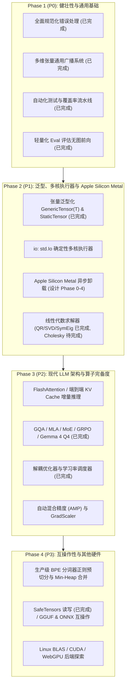

# 🗺️ ZNN 架构设计与工程规划目录 (Engineering Plans & Roadmap)

欢迎查阅 `znn` (Zig Neural Network) 的技术架构规划与工程演进文档库。本目录聚合了项目的架构诊断、功能缺口对比及分阶段研发路线图。

---

## 📂 规划文档索引 (Document Directory)

| 文档名称 | 核心主题 | 重点内容 |
| :--- | :--- | :--- |
| **[ASYNC_OFFLOAD_DESIGN.md](ASYNC_OFFLOAD_DESIGN.md)** | **异步执行与 Apple Silicon Metal 卸载设计** | • 平台优先级：Apple Silicon Metal > CPU 多核 > 其他 GPU • 并发经 `io: std.Io` 注入（Zig 0.16 `std.Io.Threaded`），`eager` / `deferred` 双执行模式 • 统一内存零拷贝 `MetalAllocator`、按流有序命令队列、运行期编译 MSL、CPU 回退 • DPS 内核改造、`hostSlice` 宿主访问协议、静态内存规划与显式 `Attention` 算子 • Phase 0 至 Phase 5 路线图与验收标准 |
| **[TODO.md](TODO.md)** | **全面现状诊断与分阶段任务清单** | • 6 个核心技术维度的现状诊断与不成熟之处 • Phase 1 (P0) 至 Phase 4 (P3) 细分开发任务 • 已交付里程碑与待完成特性的最新跟踪状态 |
| **[NUMPY_GAP_ANALYSIS.md](NUMPY_GAP_ANALYSIS.md)** | **现代 NumPy 2.x 深度对比与补齐规划** | • 科学计算底座 vs. 深度学习框架的定位差异 • 9 大能力维度的全景差距诊断表 • 泛型 Dtype、零拷贝切片、多轴归约、线性代数等具体演进方案 |

---

## 🧭 总体技术演进路线 (Architecture Evolution)

---

## 📌 当前交付重点与近期优先级

1. **已交付核心成果 (`v0.3.0` Milestone)**:
   * **全库模块化重构与单源解耦**：除 `src/models/gemma4.zig`（64,336 B，拆分已列入设计 Phase 0）外，所有非测试源码文件均 `< 60 KB`；建立 `cblas` ← `tensor` ← `autodiff` ← `nn` ← `optim` / `models` ← `engine` ← `bench` 的包级单向依赖（`zig build check-layers` 检查，并纳入 `zig build test`）与算子级逆拓扑自动微分引擎 (`topologicalSortOps`)。
   * **三层张量与线性代数系统**：`Tensor`、`GenericTensor(T)` 与编译期 `StaticTensor(T, dims)`；全维度 `sum`/`mean`/`var`/`std`/`min`/`max`/`argmin`/`argmax`；Householder `qr`、Jacobi `symeig` 与单边 Jacobi `svd`。
   * **PyTorch 风格模块协议与大模型支持**：基于 `nn.walk` 的统一反射、两阶段 `nn.initModel` 计算图初始化、GQA/MLA/MoE/LoRA/DPO/GRPO、Gemma 4 架构与 4-bit (`Q4_0`) 量化推理，以及内聚的 Schema 2.0 Web 可视化器 (`web/`)。
   * **测试与覆盖率保障**：182 项 Zig 单元/集成测试与 203 项前端 Vitest 测试 100% 通过，基于 `kcov` 的端到端代码覆盖率超 **91.7%**。

2. **下一阶段攻坚 (Immediate Next Steps)**，按 [`ASYNC_OFFLOAD_DESIGN.md`](ASYNC_OFFLOAD_DESIGN.md) 推进，Apple Silicon Metal 优先：
   * **Phase 0 执行器与基线**：基于 `io: std.Io` 的确定性执行器，`Graph.init(backing, options)` 统一入口，替换 Gemma 4 Q4 中每次调用都 spawn 线程的实现，拆分 `gemma4.zig` 并将 Q4 下沉为 `Q4MatMul` 算子。
   * **Phase 1 DPS 内核与 deferred 图**：算子拆分为 `inferShape` + `xxxInto`，`hostSlice` 宿主访问协议，录制-重放与静态内存规划。
   * **Phase 2 Metal 推理 MVP**：统一内存零拷贝、按流有序命令队列、运行期编译 MSL，跑通 Gemma 4 Q4 前向。
   * **Phase 3 注意力与 KV Cache**：显式 `Attention` 算子（FlashAttention、原生 GQA）、端到端 KV Cache 与交互式 Chat REPL；Cholesky 求解器并行推进。
